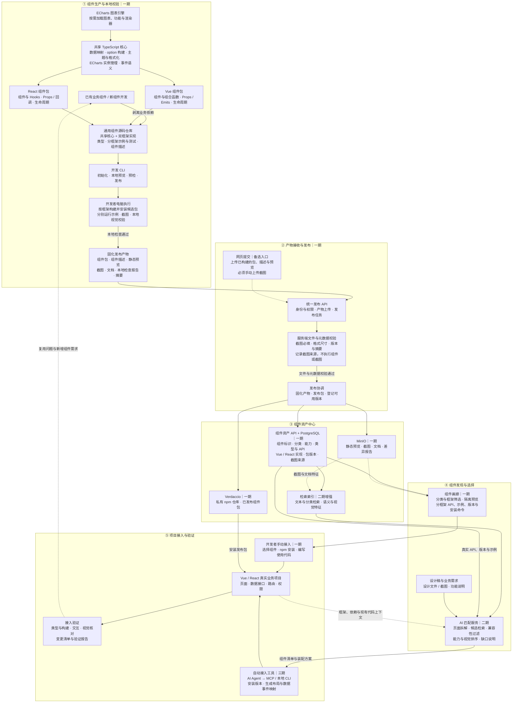
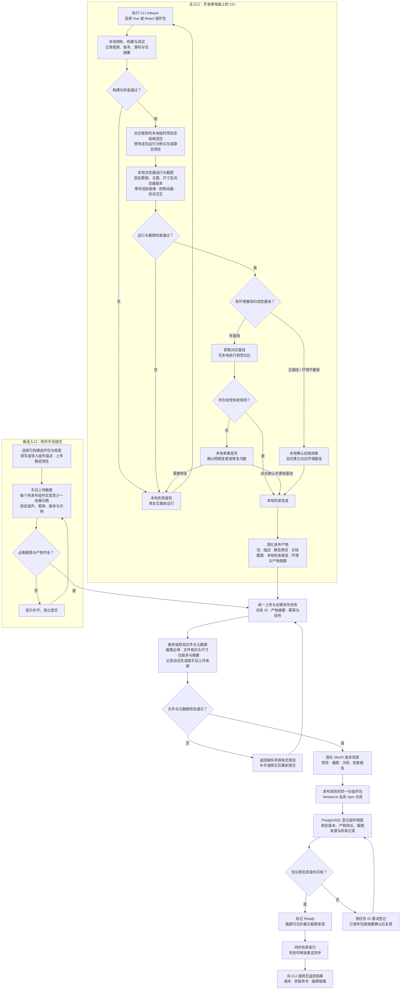
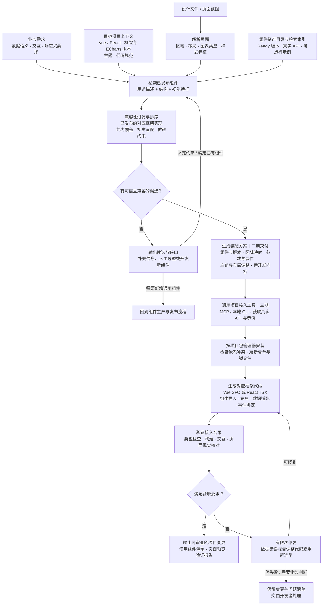
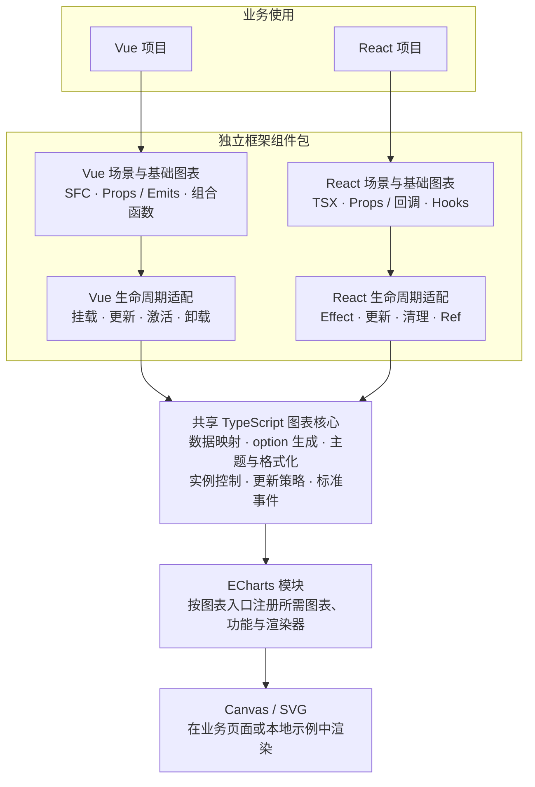
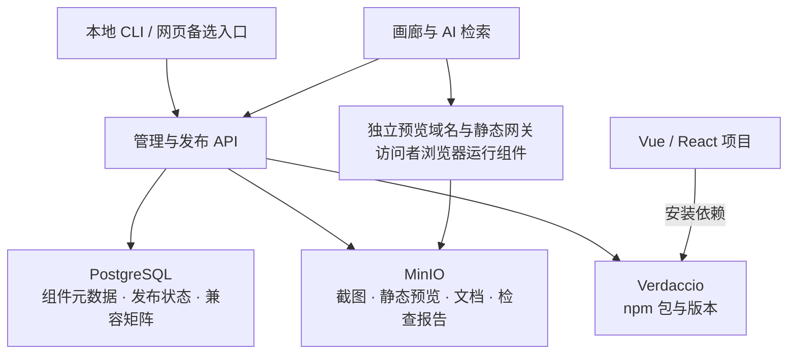
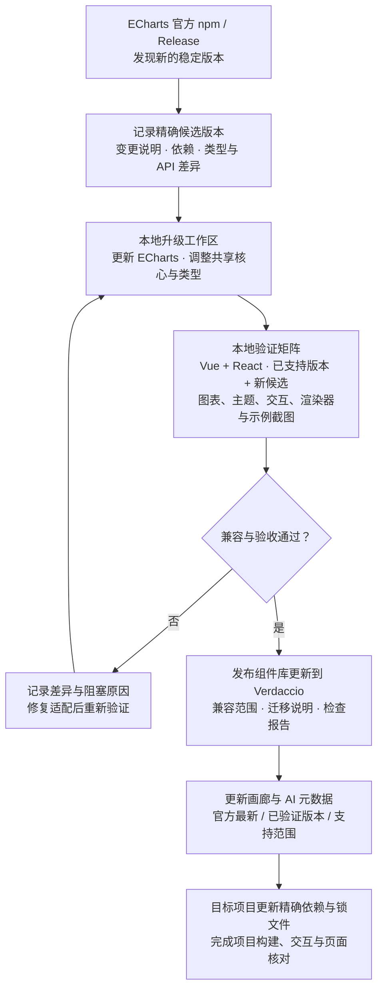

# 公司图表与组件资产平台：整体架构与流程

规划版本：2026-11-10。以下为已收敛的架构方案，尚未实施。已确定同时支持 Vue 与 React，图表引擎采用 ECharts，私有 npm 仓库采用 Verdaccio，数据库采用 PostgreSQL，对象存储采用 MinIO。

版本原则：所有选定依赖以实施时官方最新稳定版为初始基线，核实后锁定精确版本或镜像摘要；持续发现并验证新稳定版，特别是 ECharts。2026-11-10 查询得到的版本快照见第 8 节，MinIO 的实际维护和分发状态单独列明。

实现方式：共享 TypeScript 图表核心，分别提供 Vue 和 React 组件包。Vue 按 Vue 3 Composition API 设计，React 按函数组件与 Hooks 设计；组件发布时公开真实验证过的依赖范围和版本矩阵。版本查询结果不等于已通过兼容测试，若最新依赖组合存在冲突，应列出冲突并优先适配，不静默回退旧版本。

CLI 是开发与发布的主入口；网页提交仅作为备选入口。CLI 在开发者电脑上构建、运行示例、校验并截图，然后上传固化产物；网页发布必须手动上传截图。服务端负责接收产物、文件与元数据校验、npm 发布和资产登记，不运行截图浏览器。

本方案采用产物发布：两种入口均提交已构建的组件包、组件描述和预览资源，服务端不重新打包，以保持截图与实际发布包的关联。一期完成组件生产、发布、画廊与人工复用，二期增加设计稿匹配，三期完成项目自动接入。

## 1. 整体架构

实线表示主要生产、发布和消费关系；虚线表示辅助资源、上下文或反馈。每个框表示逻辑职责，不要求单独部署一个服务。

## 2. 本地截图与双入口发布流程

CLI 截图、运行检查和视觉对比均在开发者电脑上执行，不消耗服务端浏览器或截图计算资源。CLI 自动截图必须来自安装后的待发布组件包；上传后发布同一份包。网页入口要求手动上传对应版本的截图，不触发远程截图。

补充约束：

- CLI 本地阶段依赖本地进程运行；中断后重新运行或在源码和产物摘要未变化时恢复。全部产物上传且服务端接受任务后，可以凭任务 ID 查询发布状态，终端退出不影响服务端已接收的发布任务。
- 两种入口均发布预构建产物。网页用户需要先在本地准备组件包、组件描述和静态预览，并手动提供截图；服务端不构建组件、不执行组件代码、不启动截图浏览器。
- 网页截图必填规则在前端和发布 API 两端执行。每个待发布组件的每个框架实现至少关联一张有效展示截图；多组件包应分别关联，其他主题和状态按声明的展示要求补齐。
- 服务端校验权限、组件描述、包名和版本、产物摘要，以及截图的实际格式、文件大小、尺寸和关联字段。这些检查不证明手动截图与组件运行结果一致。
- CLI 来源记录为“本地自动截图 / 本地检查结果已提交”；网页来源记录为“手动上传 / 无自动回归记录”。Ready 仅表示资产可用，不代表服务端已独立复测。画廊和 AI 均保留这一区分。
- 本地运行校验包括示例可运行、无未处理错误、尺寸有效及必要交互；视觉差异阈值按场景设置。截图相似并不证明数据或交互正确。
- 画廊展示截图选取代表性场景；回归截图覆盖关键状态，均在 CLI 本地生成。网页手动截图可用于展示和视觉检索，但不能直接充当已验证的回归基线。
- 基线按组件实现、框架、示例、主题、尺寸、浏览器及操作系统等环境信息关联。CLI 固定浏览器版本、字体、语言、时区和像素比等设置，环境不兼容时提示重新建立对应基线，避免跨环境误报；建立或更新基线必须显式记录。
- CLI 截图报告记录组件与包版本、框架和 ECharts 实际版本、示例、主题、尺寸、工具和浏览器版本、包摘要与图片摘要。截图完成后不再重新打包；产物发生变化时重新校验。
- Vue 与 React 实现分别安装候选包、运行示例和截图。某一实现的检查通过或已发布，不自动代表另一实现也通过或可用；共享核心变更时，两个框架的受影响示例均需本地回归。
- npm 已发布版本不覆盖、不删除重发；若发布响应不确定，先检查该版本和包摘要，再决定重试。内容有误时发布新版本，并按需废弃旧版本。
- Ready 表示包和预览均可使用。索引是派生数据，可重建；索引失败应重试，同步恢复前 AI 不推荐该新版本。
- 预览与资源按版本保留，采用静态托管并在访问者浏览器中隔离运行。失败候选和任务报告有独立保留策略，不能覆盖已发布版本的资源。
- 此调整去掉服务端截图、视觉对比和组件构建的计算开销；包仓库、资源存储、上传带宽、发布 API 及后续 AI 服务仍需相应基础设施。

## 3. 设计稿匹配与项目自动接入流程

AI 只能从可用版本中选型，并读取截图来源和检查记录；手动上传图可参与视觉匹配，但不代表已通过自动回归验证。设计稿提供视觉结构，功能需求和项目代码提供数据与交互约束；缺失信息不能凭截图推断为事实。

## 4. 贯穿各层的共同约定

| 约定 | 内容 |
| --- | --- |
| 组件标识 | componentId 表示逻辑组件；variantId 区分 Vue / React 实现。每个实现独立关联包名、导出名、精确版本、源码摘要和可用状态。一个 npm 包可以包含多个组件。 |
| 组件描述 | 分类、用途、能力、API、事件、主题、框架及依赖范围、负责人、示例清单、截图来源及检查记录。类型与 API 优先在本地从源码生成。 |
| 示例协议 | 共享数据和语义用例，分别提供 Vue / React 示例入口；约定渲染就绪信号、尺寸与主题、必要交互和预期结果，预览、截图和文档共用。 |
| 发布产物协议 | 组件包、组件描述、静态预览、文档和必需截图；CLI 额外附本地检查报告与环境信息，按组件、版本和产物摘要关联。 |
| 数据边界 | 业务项目负责接口、权限和指标口径；通用组件接收明确数据并输出标准事件。 |
| 访问与权限 | CLI 和网页使用同一身份与权限体系；发布、基线更新和废弃操作留记录。 |
| 执行位置 | 构建、示例运行、自动截图与视觉对比在开发者电脑上执行；服务端只校验上传文件与元数据并管理发布，画廊静态示例在访问者浏览器中隔离运行。 |
| 版本生命周期 | 本地草稿、上传中、文件检查失败、待发布、发布中、Ready、已废弃；本地运行结果、基线确认与截图来源独立记录，不由 Ready 状态推断。 |
| 可观测性 | 任务进度、失败原因、发布耗时、安装与复用情况、AI 匹配及接入成功情况。 |
| 兼容与演进 | 以最新稳定版建立基线，记录官方最新版本、已验证版本、支持范围和迁移说明；通过本地双框架验证持续升级 ECharts，现有项目通过锁文件保持可复现。 |

## 5. 建设顺序

| 阶段 | 交付内容 | 验收方式 |
| --- | --- | --- |
| 一期 | ECharts 共享核心、Vue 与 React 组件包、开发发布 CLI、本地自动截图与校验、产物发布服务、Verdaccio / PostgreSQL / MinIO、分类及框架筛选画廊、静态预览、网页手动截图提交、ECharts 升级验证流程 | 同一图表的两种实现分别本地截图、经 CLI 发布，并在真实 Vue 与 React 项目安装使用；网页缺少对应实现截图时前端和 API 均拒绝发布；可追溯源码、包、截图、示例版本与来源，并能在本地验证一个指定 ECharts 候选版本。 |
| 二期 | 组件档案完善、语义与视觉检索、设计稿解析、项目约束过滤、匹配方案和缺口说明 | 用真实设计稿验证候选是否兼容、推荐理由是否成立、缺口是否完整。 |
| 三期 | MCP / 本地接入 CLI、自动依赖安装、代码生成、验证和修复 | 在真实项目生成可审查变更，通过构建、关键交互和视觉验收。 |

初期采用一个代码仓库、一个本地 CLI、一个画廊应用和一个管理 API，发布任务状态保存在 PostgreSQL，由服务端任务处理器继续推进；服务端不部署组件构建或截图执行器。npm 包由 Verdaccio 保存，元数据由 PostgreSQL 保存，预览与截图等静态资源由 MinIO 保存。语义和视觉索引在二期按规模选择实现，不预设必须建设独立向量数据库或大量微服务。

## 6. Vue + React + ECharts 技术分层

双框架支持从一期开始建设。业务数据协议、图表配置、格式化、主题和事件语义共享；组件模板、生命周期、事件绑定和使用示例分别适配框架。

### 建议包结构

以下包名为规划名称，尚未发布。

| 包 | 职责与依赖 |
| --- | --- |
| `@company/charts-core` | 框架无关的 TypeScript 逻辑与 ECharts 实例控制，供两个框架包复用；声明 ECharts 兼容范围。 |
| `@company/charts-vue` | Vue 基础图表与场景组件、组合函数和类型；依赖共享核心，声明 Vue 与 ECharts peerDependencies。 |
| `@company/charts-react` | React 基础图表与场景组件、Hooks 和类型；依赖共享核心，声明 React、ReactDOM 与 ECharts peerDependencies。 |
| `@company/component-cli` | 本地开发、构建、按框架运行预览、截图校验、上传与发布状态查询；仅用于开发阶段。 |

- 组件库产出 ESM、类型声明和明确的样式入口；Vue、React、ReactDOM 与 ECharts 作为外部依赖，避免重复打包框架或图表引擎。真实版本范围必须有兼容测试依据。
- 框架包分别发布，消费方安装对应框架包。共享核心作为依赖由包管理器安装，框架包之间没有互相依赖。
- 为高频图表提供明确的子路径入口，例如折线、柱状、饼图和散点图；每个入口使用 `echarts/core` 注册实际需要的模块，验证打包结果中的按需加载效果。
- 首期默认 Canvas，按场景提供 SVG 选项；截图使用该示例声明的渲染器并记录，不能仅为截图替换渲染器后宣称验证了实际运行效果。

### 组件与生命周期约定

- 优先实现折线、柱状、饼图 / 环图、散点等基础图表，再组合趋势卡片、排名和占比场景组件。首批组件分别提供 Vue 与 React 实现和独立示例。
- 普通场景输入明确的数据、字段映射、单位、主题与交互配置；共享核心转换为 ECharts option。高级用法通过带类型的 option 扩展和必要的实例能力开放，覆盖优先级与事件副作用需要明确。
- 两种实现共享数据结构和事件载荷语义，按框架惯例暴露接口，例如 Vue 的 `point-click` 事件对应 React 的 `onPointClick` 回调；发布档案分别记录真实 API 和代码示例。
- 适配层负责在挂载且容器尺寸有效时初始化，使用 ResizeObserver 处理尺寸变化；卸载时解除事件、观察器并销毁实例。Vue KeepAlive 恢复时处理尺寸变化，React Effect 的建立与清理需要兼容 StrictMode 重复执行。
- 更新策略区分数据更新、系列删除和主题 / 渲染器变化；使用稳定 series 标识和适当的替换策略避免残留系列，并为主题等需重建的情形维护明确的实例生命周期。
- 实例创建限定在客户端挂载阶段；可导入代码应避免顶层访问 DOM。若支持 SSR 宿主，图表在客户端渲染，服务端输出容器占位；该边界需要在兼容范围中说明并验证。

### 本地预览与截图约定

- 建议使用 Vite 分别构建 Vue 和 React 示例应用，CLI 调用本地 Playwright 与固定版本 Chromium 执行截图。浏览器安装、缓存和运行均在开发者电脑上完成。
- 两套示例应用安装各自待发布的 tarball，并解析对应共享核心依赖；涉及尚未发布的共享核心时，先在本地安装其候选产物完成验证，再按依赖顺序发布，框架包进入 Ready 前确认依赖可获取。
- 示例通过统一的就绪协议报告数据、字体、容器和 ECharts 渲染完成。截图模式关闭动画和不确定数据，结合 ECharts 渲染完成信号、明确超时与页面错误检测执行，避免仅靠固定延时。
- 元数据记录框架、框架版本、ECharts 版本、渲染器、示例、主题、尺寸、系统环境与包摘要。共享核心的数据与事件逻辑集中验证，两个框架分别验证挂载、更新、销毁、交互和截图。

### 画廊与 AI 的框架识别

- 画廊按逻辑组件组织页面，支持 Vue / React 筛选或切换；仅展示真实已发布的对应实现、截图、预览、API、示例和安装命令。
- 逻辑组件可以共用用途和标签描述；包名、版本、API、示例、截图、基线与可用状态按框架实现分别登记。
- AI 先识别目标项目的框架和依赖范围，再选择兼容的已发布实现；分别生成 Vue SFC 或 React TSX，并读取对应实现的真实事件与类型定义。
- 只有 Vue 实现的组件不能直接作为 React 可安装组件推荐，反之亦然；缺少实现时输出适配缺口并进入组件生产流程。

## 7. 已确定的存储职责与发布一致性

| 产品 | 保存内容 | 接入与部署约定 |
| --- | --- | --- |
| Verdaccio | 公司 npm 包、版本元数据，以及按配置缓存的公共依赖 | CLI 或发布服务通过 npm 协议发布，项目通过 npm / pnpm 安装；包数据使用独立持久化卷。首期不假设已安装 MinIO 存储插件。 |
| PostgreSQL | 逻辑组件、框架实现、发布版本、分类、API、依赖兼容矩阵、发布任务、资源引用、操作记录 | 管理 API 统一读写；保存 MinIO 对象键和摘要、Verdaccio 包名与版本等引用，保持状态可追踪。 |
| MinIO | 静态预览文件、截图、文档、视觉基线、差异和检查报告 | 使用 S3 API，资源按组件实现、版本和内容摘要组织；已发布资源保持不可变。 |

- 发布采用可重试的任务状态机：验证上传文件 → 固化 MinIO 资源 → 发布同一份包到 Verdaccio → 登记 PostgreSQL → 标记 Ready → 同步索引。三个存储之间不存在跨系统原子事务，失败后按任务 ID 与产物摘要恢复。
- API 记录 npm 包版本、依赖版本、截图来源和检查报告之间的关系；已发布包不覆盖，暂未登记成功的包通过任务恢复补齐，未引用的暂存资源按保留策略清理。
- 静态预览由独立域名与网关按授权提供完整目录，访问者浏览器加载并执行；MinIO 负责对象保存，服务端不渲染图表或生成截图。
- Verdaccio 的 npm 包持久化与 MinIO 的静态资源保存分别配置。后续如需把 npm 包转存 S3，应先验证存储插件兼容性，再单独迁移。

## 8. 最新稳定版本基线与来源

核实日期：2026-11-10（Asia/Shanghai）。npm 依赖读取官方 Registry 的 `latest` 标签，并检查选中的版本是否为稳定版；PostgreSQL 读取官方版本支持页，Node.js 读取官方发行列表，MinIO 读取官方仓库和最新 Release。下表是当前规划快照，实际初始化或部署时重新查询并记录解析结果。

| 产品 / 依赖 | 本次查到的稳定版本 | 官方来源 |
| --- | --- | --- |
| ECharts | 6.1.0 | [npm 元数据](https://registry.npmjs.org/echarts/latest)；[官方 Release](https://github.com/apache/echarts/releases/tag/6.1.0) |
| Vue | 3.5.45 | [npm 元数据](https://registry.npmjs.org/vue/latest) |
| React / ReactDOM | 19.3.1 / 19.3.1 | [React](https://registry.npmjs.org/react/latest)；[ReactDOM](https://registry.npmjs.org/react-dom/latest) |
| Verdaccio | 7.1.0 | [npm 元数据](https://registry.npmjs.org/verdaccio/latest) |
| PostgreSQL | 18.6 | [官方版本支持页](https://www.postgresql.org/support/versioning/) |
| MinIO Community Server | RELEASE.2025-10-15T17-29-55Z（最新公开 Release；仓库已归档） | [Release](https://github.com/minio/minio/releases/tag/RELEASE.2025-10-15T17-29-55Z)；[仓库与 README](https://github.com/minio/minio) |
| Node.js | 26.13.0（官方标记 LTS：Lithium） | [官方发行列表](https://nodejs.org/dist/index.json) |
| TypeScript | 7.0.2 | [npm 元数据](https://registry.npmjs.org/typescript/latest) |
| Vite | 8.3.7 | [npm 元数据](https://registry.npmjs.org/vite/latest) |
| @vitejs/plugin-vue | 6.0.10 | [npm 元数据](https://registry.npmjs.org/%40vitejs%2Fplugin-vue/latest) |
| @vitejs/plugin-react | 6.3.0 | [npm 元数据](https://registry.npmjs.org/%40vitejs%2Fplugin-react/latest) |
| @playwright/test | 1.65.0 | [npm 元数据](https://registry.npmjs.org/%40playwright%2Ftest/latest) |
| vue-tsc | 3.3.14 | [npm 元数据](https://registry.npmjs.org/vue-tsc/latest) |
| pnpm | 12.18.0 | [npm 元数据](https://registry.npmjs.org/pnpm/latest) |

本次仅核实公开版本与依赖声明，未安装上述组合，未运行构建或兼容测试。Chromium 随所选 Playwright 版本安装并记录实际修订号；后续新增依赖同样解析最新稳定版并记录，不能仅凭此表宣称整个工程已验证。

### MinIO 的实际版本边界

截至核实日，官方 `minio/minio` 仓库 API 显示 `archived: true`，README 明确写有“THIS REPOSITORY IS NO LONGER MAINTAINED”，并说明社区版采用源码分发，历史预编译二进制不再维护。最新公开 Release 为上表的 2025-10-15 版本。

保留用户指定的 MinIO 选型。当前社区版部署基线采用该正式 Release 源码构建，记录源码提交和最终镜像摘要；不将旧镜像的浮动 `latest` 标签当成“最新受维护版本”。若将来需要持续获得官方维护版本，需单独评估官方 README 指向的 AIStor 产品；它与本方案中的社区版不是同一个发布通道，不能直接混用版本承诺。

### 依赖锁定与基础设施升级

- 新工程初始化时解析最新稳定版本，应用开发依赖保存精确版本并提交锁文件；服务镜像记录具体版本和 digest，生产部署由版本清单驱动。
- 组件库的 peerDependencies 表达验证过的兼容边界；官网最新版本、精确实测版本和允许范围分别记录。面向未来的宽泛范围不能替代验证。
- npm 最新标签只作为版本发现入口，查询需考虑 Verdaccio 代理缓存；选择新候选后记录精确版本和包摘要，安装及发布按该结果执行。
- PostgreSQL 新大版本需要数据备份、迁移与恢复演练；Verdaccio 和 MinIO 升级需要验证元数据与存储格式兼容性。正式部署升级前验证恢复路径，不能把数据库升级等同于简单替换依赖锁文件。

## 9. ECharts 持续跟随升级

目标：及时发现并适配 ECharts 官方最新稳定版，将升级工作集中到共享核心，经过双框架本地验证后发布组件库兼容更新。业务项目通过明确的依赖更新采用新版本，既有发布仍可按锁文件重现。

### 升级能力

- 在开发和发布 CLI 中提供版本检查；本地升级命令接收指定版本或解析官方最新稳定版，生成可审查的依赖变更。命令接口在实现计划中确定，此处描述的是待建设能力。
- 可接入依赖更新机器人自动创建升级候选；机器人只读取版本与变更信息，构建、组件运行、截图及视觉对比仍由本地 CLI 执行。本次规划不创建定时任务或安装机器人。
- 所有 ECharts 调用、模块注册和版本差异收敛到共享核心的引擎适配模块。使用公开 API，保留带类型的高级配置入口；普通图表尽量使用公司数据与事件协议减少业务改动。暴露原生 option / 实例的高级用法仍需按上游变更核对。
- patch、minor 和 major 均进入验证流程。major 升级重点核对配置项、主题默认值、事件、类型和模块导出变化；存在公司公共 API 破坏时按组件库版本规则提供迁移说明。
- 对精确已支持版本和新候选执行验证。只维护实际承诺的兼容矩阵，新增大版本先作为候选，不提前扩大 peerDependencies；验证通过后才更新声明和资产目录。
- ECharts 自带 TypeScript 类型作为适配依据。新配置先可通过高级 option 入口使用，有复用价值时再纳入公共组件 API，避免为追随每一个引擎配置同步扩张组件协议。

### 本地升级验收与回退

- 基础验证：构建与类型、模块按需加载、系列新增删除、resize、实例清理、Vue 激活恢复与 React StrictMode 行为。
- 表达与交互：单位和缺失值、主题、图例、tooltip、缩放、点击载荷、Canvas / SVG，以及实际支持的大数据与更新场景。
- 视觉验证：固定数据、字体、尺寸和浏览器，分别运行 Vue / React 示例；变更必须有差异报告，预期视觉变化显式更新基线。
- 发布记录同时保存 ECharts 精确版本、组件包版本、适配变化和本地报告。画廊显示“已验证至哪个版本”，AI 依据最新验证记录选择包与引擎版本。
- 新版本出现回归时，项目可以恢复上一套已验证的组件库、ECharts 精确版本及锁文件；上游版本不覆盖，后续通过修复版本继续升级。

“跟随最新”在本方案中是可执行的持续适配与验证流程；这次完成的是架构定义和公开版本核实，尚未实现该升级工具或证明上述组合兼容。
