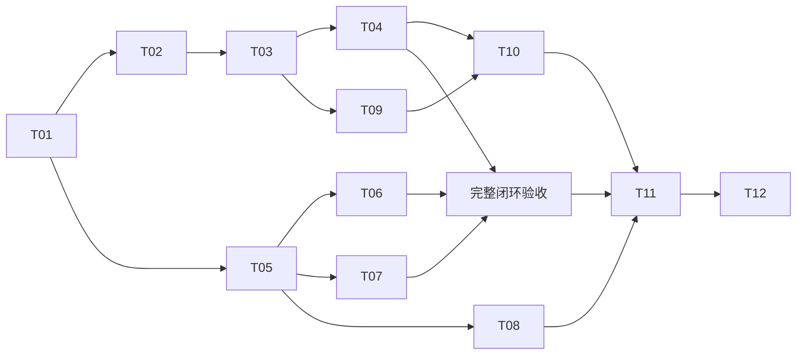

# 图表与组件资产平台 Implementation Plan

> **For agentic workers:** REQUIRED SUB-SKILL: Use superpowers:subagent-driven-development (recommended) or superpowers:executing-plans to implement this plan task-by-task. Steps use checkbox (`- [ ]`) syntax for tracking.

**Goal:** 完成可追溯、可恢复的双框架组件生产发布平台；建议 2026-12-31 验收一期，二三期按独立质量门槛推进。

**Architecture:** 采用 Monorepo + pnpm workspace + Turborepo，单仓保存共享图表核心、Vue/React 适配、CLI、画廊和管理 API；pnpm 管理依赖，Turbo 编排开发任务与缓存。组件构建、示例运行、截图与视觉差异在开发者电脑执行；服务端只处理预构建产物，通过 PostgreSQL 持久化任务协调 Verdaccio、PostgreSQL 和 MinIO。AI 检索和自动接入在后续独立任务中实现。

**Tech Stack:** TypeScript、pnpm workspace、Turborepo（npm 包 `turbo`）、ECharts、Vue/React 组件、React + Vite 平台前端、NestJS 平台 API/预览网关、Playwright、PostgreSQL、Verdaccio、MinIO/S3 API；Vitest 验证单元与服务集成。用户已明确平台后端 NestJS、前端最新稳定 React；当前锁定 NestJS 12.4.2（Express 适配器）、React 19.3.1，见 [调整验证](../../verification/nest-react-bootstrap.md)。Zod、pg、S3 SDK 和 OpenAPI 生成器仍属计划建议，实施时查询并验证。

**Spec:** `D:/project/zhinexus-design-asset-platform/component-platform-architecture.md`。范围与预算见项目根目录 `component-platform-implementation-assessment.md`。2026-11-11 已完成 [工程初始化子集](2026-11-11-bootstrap-execution.md)，[验证记录](../../verification/bootstrap.md) 仅覆盖工程骨架，完整 T01 保持开放。当前人员与日历以 [三人分工计划](2026-11-11-three-person-allocation.md) 为准。

## Global Constraints

- 用户补充确认：采用 Monorepo + pnpm workspace + Turborepo；Turbo 只负责仓库任务，不承担线上发布作业调度。
- 用户补充确认：平台前端使用 React，API/预览网关使用 NestJS；组件侧 Vue 与 React 支持范围保留。
- 原文：“已确定同时支持 Vue 与 React，图表引擎采用 ECharts，私有 npm 仓库采用 Verdaccio，数据库采用 PostgreSQL，对象存储采用 MinIO。”
- 原文：“所有选定依赖以实施时官方最新稳定版为初始基线，核实后锁定精确版本或镜像摘要”。当前版本证据仅为候选输入。
- 原文：“若最新依赖组合存在冲突，应列出冲突并优先适配，不静默回退旧版本。”
- 原文：“网页发布必须手动上传截图。”每个待发布组件的每个框架实现至少一张，前端和 API 均校验。
- 原文：“服务端不构建组件、不执行组件代码、不启动截图浏览器。”服务端镜像不能包含组件构建或截图任务入口。
- 原文：“截图完成后不再重新打包；产物发生变化时重新校验。”同一份 tarball 摘要贯穿安装、截图、上传与发布。
- 原文：“npm 已发布版本不覆盖、不删除重发”。同版本不同摘要报冲突；Ready 与报告来源、基线状态、索引状态独立。
- 原文：“CLI 和网页使用同一身份与权限体系；发布、基线更新和废弃操作留记录。”
- 一期 7 个逻辑组件、14 个框架实现是本计划建议范围；名称见 T09。初始本地支持 Windows 11 x64；其他系统须单独验证。
- 只承诺实测的框架/ECharts 兼容范围。SSR 仅安全导入与客户端挂载；不生成服务端图表。

## Review Focus

1. 一包多组件、部分实现缺图时不能误放行，也不能把 Vue 截图算到 React；T01/T05/T08 覆盖逐实现关联和拒绝测试。
2. Verdaccio 已接收但请求超时、数据库登记失败、两个 worker 抢同一任务时不能重复发布或登记错误内容；T06/T11 覆盖故障注入。
3. 候选 core 尚未发布、示例错误使用源码别名、截图后重新 pack 时不能宣称验证的是发布包；T03/T04/T06 覆盖真实包和摘要检查。
4. 隐藏容器、StrictMode、KeepAlive、主题切换及数据缩减不能泄漏实例或残留系列；T02/T03/T10 覆盖生命周期和事件测试。
5. 预览目录穿越、脚本获取平台凭证、权限撤销后的资源访问不能绕过授权；T05/T07/T11 覆盖恶意产物与浏览器隔离测试。

---

## 1. 文件结构与执行约定

以下路径全部拟新增；不存在需要沿用的现有工程风格。默认范围为当前项目目录，不修改相邻项目。

```text
apps/
  api/src/                 # NestJS 模块、HTTP API、身份、发布任务、资产目录
  api/migrations/          # PostgreSQL schema 与版本迁移
  gallery/src/             # React 画廊、详情、上传、任务进度
  preview-gateway/src/     # NestJS 独立域名静态文件授权网关；不是执行器
packages/
  contracts/src/           # manifest、示例、报告、API/AI 协议
  charts-core/src/         # 数据、option、模块注册、实例控制
  charts-vue/src/          # SFC、composable、事件适配、样式
  charts-react/src/        # TSX、hook、事件适配、样式
  component-cli/src/       # 本地构建验证、上传、升级；三期接入
examples/
  fixtures/               # 双框架共用确定性数据
  vue/                    # Vue 示例源才
  react/                  # React 示例源
tests/
  contracts/ unit/ integration/ browser/ consumers/
  fixtures/releases/      # 合法/缺失/冲突/恶意产物样本
infra/
  compose.yaml            # 本地服务联调环境
  verdaccio/ minio/ gateway/
scripts/                  # 版本查询、工作区验证、部署检查
docs/                     # 使用文档、运维手册、验收记录
```

内部包建议名：`@company/contracts`、`@company/platform-api`、`@company/gallery`、`@company/preview-gateway`。四个公开包沿用架构规划名称；对外 CLI 二进制命令名为 `component`。

T01 建立根目录 `package.json`、`pnpm-workspace.yaml`、`pnpm-lock.yaml`、`turbo.json`、`.gitignore`、`tsconfig.base.json`、`vitest.config.ts` 与 `tests/playwright.config.ts`。验证命令从仓库根目录运行：

- `pnpm typecheck`、`pnpm build`：通过 Turbo 执行工作区类型检查和构建，组件相关任务仅在本机执行。
- `pnpm dev`：通过 Turbo 启动工作区开发任务；可按包筛选。
- `pnpm exec vitest run <test-file>`：指定单元/契约/集成测试。
- `pnpm exec playwright test <test-file> --config tests/playwright.config.ts`：本机浏览器测试。
- `pnpm test:infra`：在隔离服务环境验证 PG/MinIO/Verdaccio；不得连生产数据。
- `pnpm exec component <command>`：在本地工作区安装 CLI 后执行。

有行为变更的任务先写针对性失败测试，再实现，再运行同一测试和相关类型/构建检查。测试应断言结果与故障行为，不能只对实现细节做快照。配置/文档不要求机械添加单元测试。每个任务验证后单独形成可审查提交；Git 在 T01 初始化，不假设当前已有仓库。

### 1.1 工作区成员与依赖边界

`pnpm-workspace.yaml` 的成员范围固定为以下入口；`examples/fixtures` 是数据目录，`tests/consumers` 是消费者模板，均不作为工作区包。消费者实际安装与运行目录由 T03 在工作区外创建。

```yaml
packages:
  - 'apps/*'
  - 'packages/*'
  - 'examples/vue'
  - 'examples/react'
```

根 `package.json` 设 `private: true`，固定 pnpm 版本声明并以根 `pnpm-lock.yaml` 安装。所有成员具有唯一包名；应用、contracts 和示例默认 `private: true`，四个对外包显式维护版本及导出。内部依赖声明为 `workspace:*`；pnpm pack 后必须检查 tarball 清单已转换成实际精确版本，不残留工作区协议或源码路径。该转换发生在冻结前；消费者用候选 core 的临时 overrides，不能重新改写已冻结的框架包。

依赖方向为框架包依赖 `charts-core`，各示例依赖相应框架包，平台服务和 CLI 按需依赖 `contracts`。API、预览网关、contracts 不依赖图表运行时或示例；画廊通过 API 和隔离预览展示上传组件。共享代码通过包 exports 引用，不跨包导入 `src`。T01 的 `verify-workspace.ts` 检查成员范围、循环依赖、私有包标记和服务端依赖边界。

公开 CLI 使用私有 contracts 时，将其作为工作区构建依赖，并在 CLI 产物中内联所需运行时代码和类型；发布清单不得留下无法从注册表安装的私有包依赖。四个公开包的独立安装测试同时检查这一点；core 仍按 T03/T06 的独立包规则消费和发布。

### 1.2 Turbo 任务、输入输出与缓存

根脚本初始映射如下；叶子包的 `build`、`typecheck`、`dev` 直接调用自己的编译器、检查器或开发服务器，不能再调用根 Turbo 入口导致递归。每个需要检查的成员显式提供对应脚本，避免任务缺失被误认为通过。

```json
{
  "scripts": {
    "build": "turbo run build --cache=local:rw",
    "typecheck": "turbo run typecheck --cache=local:rw",
    "dev": "turbo run dev --cache=local:rw"
  }
}
```

`turbo.json` 初始方案如下，T01 按实际锁定版本核对配置。构建产物统一放在各包 `dist/`；初始类型检查采用无输出、关闭增量写入的模式。以后启用 `.tsbuildinfo` 时，应为该任务指定独立路径并同步补齐 `outputs`，不能与构建任务争用同一个增量文件。

```json
{
  "$schema": "https://turborepo.dev/schema.json",
  "globalDependencies": [
    "tsconfig.base.json",
    "pnpm-workspace.yaml",
    "docs/versions.lock.json"
  ],
  "globalEnv": ["NODE_ENV"],
  "tasks": {
    "build": {
      "dependsOn": ["^build"],
      "outputs": ["dist/**"]
    },
    "typecheck": {
      "dependsOn": ["^build"],
      "outputs": []
    },
    "dev": {
      "dependsOn": ["^build"],
      "cache": false,
      "persistent": true
    }
  }
}
```

`^build` 保证先完成上游包构建；例如 core 构建先于 Vue/React 包，各框架包先于相应示例。类型检查也等待上游声明文件生成。开发任务是常驻进程，其他任务不能依赖它的退出；需要联动修改上游时，提供包自身的 watch 流程。

保留 Turbo 默认源码输入和锁文件跟踪；根共享 TS 配置与工具版本清单纳入全局输入，新增共享构建配置时同步补充。若定制任务 `inputs`，保留 `$TURBO_DEFAULT$`，并将读取的跨目录 fixture、配置等显式加入。所有影响输出的环境变量必须声明在任务 `env` 或 `globalEnv` 中；涉及未建模外部状态时关闭该任务缓存。`.gitignore` 忽略 `node_modules/`、`.turbo/`、`dist/` 及临时报告/冻结目录；需追踪的基线和版本证据单独保留。工具链版本、OS 等运行差异在 T01 校验，一期使用本地缓存，不配置远程缓存服务。

| 任务类别 | 执行与缓存约定 |
| --- | --- |
| 日常构建、类型检查 | 使用上述 Turbo 任务；允许命中缓存，声明实际产物和全部有效输入。构建命中不代表完成发布验收。 |
| 包内纯单元测试 | 后续确实建立包级脚本后可纳入 Turbo 缓存；补充测试配置、fixture 输入和 coverage 输出；不能把当前根 `tests/` 当作已存在的包级任务。 |
| 根目录契约/单元/服务集成测试 | 保持 `pnpm exec vitest run <test-file>` 直接执行。连接 PG/MinIO/Verdaccio 的验证与 `pnpm test:infra` 每次实际运行。 |
| 本机浏览器、视觉回归、升级验收和真实 tarball 消费 | 保持直接 Playwright/Vitest/CLI 调用；每次建立实际运行记录，不用缓存报告替代截图或隔离安装。 |
| pack/冻结、上传、发布、恢复、基线更新 | 直接由 CLI/API 执行，不作为可缓存构建任务；冻结目录、报告和凭证不进入构建 outputs。 |
| dev/watch | `cache: false`、`persistent: true`；只用于开发。 |

上述直接入口若以后包装为 Turbo 任务，必须显式 `cache: false`，且调用者不能通过另一个可缓存任务间接跳过它。T04 需验证连续两次 check 都运行检查器并生成各自执行记录；上传重试可复用已冻结且摘要一致的原始材料，但不宣称已重新检查。

服务端 CI 使用明确白名单，例如 `pnpm exec turbo run build typecheck --filter=@company/platform-api --filter=@company/preview-gateway --cache=local:rw`；先审查 `--dry=json` 的实际图，仅包含目标服务及 contracts 等安全依赖。CI 不执行根全量 `pnpm build`，不运行组件包/示例或发布截图链路。Turbo 任务图与 T06 的 PostgreSQL 作业状态机独立。

配置依据（2026-11-11 读取官方文档源码；不是已运行证据）：`https://raw.githubusercontent.com/vercel/turborepo/main/apps/docs/content/docs/reference/configuration.mdx`、`https://raw.githubusercontent.com/vercel/turborepo/main/apps/docs/content/docs/reference/run.mdx`、`https://pnpm.io/workspaces`。实施时重新核对已锁定版本对应的文档。

## 2. 贯穿任务的协议决定

### 2.1 发布身份与数据库模型

| 表 | 主键或唯一约束 | 内容与关系 |
| --- | --- | --- |
| components | component_id | 逻辑组件、标签、分类、负责人；标签关系单独存表 |
| variants | variant_id；unique(component_id, framework) | Vue/React 实现及真实导出路径、名称 |
| package_releases | unique(package_name, package_version) | tarball 摘要、源码摘要、registry integrity、依赖、可用性；core 也在此表 |
| variant_releases | unique(variant_id, package_release_id) | component API、文档、示例、截图、兼容性和弃用状态 |
| artifacts | sha256 + 对象键唯一 | 资源类型、字节数、实际 MIME、不可变对象路径 |
| release_jobs | job_id；unique(subject, idempotency_key) | manifest 摘要、状态、步骤、attempt、租约、fencing token、next_attempt_at |
| upload_sessions / upload_files | session_id；unique(session_id, logical_path) | 上传人、预期摘要、分片信息、完成与失效时间 |
| examples / screenshots / check_reports | 各自 id；关联 variant_release_id | 示例语义、环境签名、截图来源、包/图摘要和报告 |
| baselines / baseline_revisions | baseline_id / revision_id | 环境键、候选图、操作者、原因、版本；更新追加 revision |
| compatibility_records | variant_release_id + 精确依赖组合 | 官方候选、实测版本、运行环境、通过时间和报告引用 |
| audit_events / usage_events | event_id | 发布、基线、废弃操作与最小必要的使用统计；不存凭证 |
| index_outbox | event_id；unique(variant_release_id, revision) | 索引任务与版本修订，独立重试；一期记录，二期实际消费 |

package_release 是 npm 包粒度，variant_release 是可展示实现粒度；不能用同一行混合两者。首版发布包清单必须列出包内全部受管理组件导出，并为所有这些实现提供材料，避免一个整包版本只有部分组件被无意登记。

### 2.2 Manifest 与来源规则

`packages/contracts/src/release-manifest.ts` 导出 `ReleaseManifestV1` 和 `validateManifest(input: unknown): ValidationResult<ReleaseManifestV1>`，使用 schema 做运行时校验并生成 JSON Schema。类型固定包括：

```ts
type Framework = 'vue' | 'react';
type ScreenshotSource = 'local-automatic' | 'manual-upload';
type ReleaseChannel = 'cli' | 'web';
type Sha256 = string; // 校验为 64 位小写十六进制
type ArtifactRef = { path: string; sha256: Sha256; bytes: number };
type PackageRef = {
  name: string; version: string; tarball: ArtifactRef;
  sourceDigest: Sha256; sourceCommit?: string;
  dependencies: Record<string, string>;
  peerDependencies: Record<string, string>;
};
type VariantRef = {
  componentId: string; variantId: string; framework: Framework;
  packageName: string; packageVersion: string;
  exportPath: string; exportName: string;
  api: ArtifactRef; docs: ArtifactRef; examples: ExampleRef[];
  screenshots: ScreenshotRef[]; compatibility: CompatibilityRecord[];
};
type ReleaseManifestV1 = {
  schemaVersion: 1; channel: ReleaseChannel;
  packages: PackageRef[]; variants: VariantRef[];
  files: ArtifactRef[]; reports: ArtifactRef[];
};
```

辅助类型统一放在 `packages/contracts/src/examples.ts` 和 `reports.ts`：

- `ExampleRef`：id、previewEntry、previewFiles、fixtureDigest、renderer、theme、width、height、requiredStates。previewEntry 必须属于 previewFiles；各资源同时出现在 manifest.files。
- `ScreenshotRef`：id、variantId、framework、packageVersion、exampleId、state、source、image、packageSha256、environmentKey、reportId（手动可省略）。image 为 ArtifactRef；variantId/framework 必须与所属 VariantRef 一致，不可跨实现借图。
- `EnvironmentV1`：os、arch、browserVersion、browserRevision、fontDigest、locale、timezone、deviceScaleFactor、renderer、width、height、theme、frameworkVersion、echartsVersion。
- `CompatibilityRecord`：framework、frameworkVersion、reactDomVersion（React 必填）、echartsVersion、status（candidate/passed/failed）、reportId、verifiedAt（通过时必填）。
- `CheckReportV1`：id、toolVersion、variantId、packageSha256、exampleId、environment、checks（name/status/evidence）、screenshots、baselineRevision、baselineResult（PASS/DIFF/NEW/INCOMPATIBLE）、createdAt。
- `ValidationResult<T>`：`{ok:true,value:T}` 或 `{ok:false,issues:{code,path,message}[]}`。

environmentKey 使用规范化的 os/arch/browserVersion/browserRevision/fontDigest/locale/timezone/deviceScaleFactor/renderer/width/height/theme 计算；组件实现与 exampleId 作为外层基线键。frameworkVersion、echartsVersion 和组件包版本是本次被验证对象，只记录在报告中，不进入环境相容性键，否则升级会永远无法与旧基线对比。手动截图允许 environmentKey=`unknown-manual`，运行环境未知就显示未知，不填写虚构浏览器信息；该值不能用于基线接受。

ReleaseManifest 采用确定性 JSON 编码后计算摘要；文件摘要逐项重新计算。源码摘要是本次构建所用源码集合的规范化路径/内容摘要，Git commit 可选且不能单独证明无未提交变化。

web 入口截图强制标记 manual-upload，不能通过提交字段升级为自动验证。CLI 来源是“客户端报告已提交”的声明，API 可验证摘要关联，无法独立证明本地运行真实发生。画廊显示这一区别。手动图不能直接成为通过验证的回归基线。无关联的本地检查报告时，compatibility 只能为空或 candidate，不能提交 passed；包声明的 peerDependencies 与实际兼容验证记录分别展示。

### 2.3 服务接口与生命周期

所有 API 为 `/v1`，返回结构化错误 `{code,message,details,requestId}`；subject 从鉴权获取，不相信客户端提交。只对读取、创建上传会话和任务状态使用必要的权限。

| 接口 | 输入 → 输出 |
| --- | --- |
| POST /uploads | `{manifestDigest,files}` → `{uploadSessionId,files:[{path,uploadUrl,expiresAt}]}`；大文件提供分片会话 |
| POST /uploads/:id/complete | `{parts}` → `{status:'complete',verifiedFiles}`；重新核对全部摘要和尺寸 |
| POST /releases | Header `Idempotency-Key`；`{uploadSessionId,manifest}` → `202 {jobId,state}` |
| GET /releases/:jobId | `{state,stage,attempt,lastError,missingArtifacts,pollAfterMs}` |
| POST /releases/:jobId/retry | 可恢复失败 → 同任务重试；内容变更必须新任务 |
| GET /components | framework/category/query/page → Ready 目录及分页 |
| GET /variants/:id/releases/:version | 完整档案、精确安装组合、截图来源、检查记录 |
| POST /baselines | `{variantId,exampleId,environmentKey,screenshotId,reason,expectedRevision}` → 新 revision |
| POST /variant-releases/:id/deprecate | `{reason}` → 废弃状态和审计事件 |
| POST /preview-grants | `{variantReleaseId}` → `{bootstrapUrl,expiresAt}` |

发布流程：UPLOADING → VALIDATING → PENDING → PUBLISHING → READY。校验失败为 REJECTED；可恢复基础设施失败为 RETRY_WAIT，记录 checkpoint；摘要冲突为 CONFLICT，人工处理。任务和资产状态分开，资产可以另行 DEPRECATED。

PUBLISHING 的 checkpoint：FINALIZE_OBJECTS → ENSURE_PACKAGES → REGISTER_ASSETS → CHECK_AVAILABILITY → READY_TX。core 等公司依赖按拓扑顺序发布；循环依赖拒绝。READY_TX 同一 PG 事务写入 Ready、审计和 index_outbox。索引失败不撤销 Ready；二期 AI 仅取索引修订已同步且当前仍 Ready 的结果。

## 3. 一期任务



箭头表示验收依赖；接口冻结后可用契约 stub 并行开发，但 M2/T11 必须连接真实产物与服务。

### T01：锁定基线、Monorepo/Turbo 工程骨架与公共协议（5–7 人日）

**Files:** 创建第 1 节根配置，包含 `turbo.json`、`pnpm-workspace.yaml`、根/成员 `package.json` 和 `.gitignore`；`scripts/resolve-versions.ts`、`scripts/verify-workspace.ts`、`scripts/test-infra.ts`；`packages/contracts/src/{release-manifest,examples,reports,index}.ts`；`infra/compose.yaml`、`infra/verdaccio/config.yaml`、`infra/minio/Dockerfile`；`tests/contracts/release-manifest.test.ts`；`docs/versions.lock.json`、`docs/verification/turbo-baseline.md`。

**Interfaces:** 输入原架构、本次版本证据和已确认的 Monorepo/pnpm/Turbo 选型；输出第 2 节 schema、工作区成员/任务图、基础验证命令、精确版本/镜像清单与可用开发服务地址。任务不预先承诺任何未经运行的 peerDependencies 范围。

- [ ] 解析实施当天官方 latest，排除预发布；记录 engines/peerDependencies/optional 标记、来源时间和 dist integrity。Node 选择最新稳定候选；此次证据 v26.13.0 可作起点。新增依赖包含 `turbo`，核对其与 pnpm/Node 的兼容性后锁定；禁止复制旧快照直接宣称最新。
- [ ] 按第 1.1/1.2 节建立 pnpm workspace、根锁文件、Turbo 配置和根/叶子脚本；初始化最小成员以校验依赖图。`verify-workspace.ts` 检查无漏掉的成员/必需脚本、无递归 Turbo 调用、无服务端图表依赖；消费者模板不进入 workspace。
- [ ] 为 contracts 写 `rejects_react_variant_using_vue_screenshot`、`rejects_duplicate_package_version_with_different_digest`。分别断言关联错误、唯一性错误；先运行确认失败，再实现第 2 节 schema。
- [ ] 在本地验证 ECharts + Vue + React + TypeScript/Vite 最小组合；安装并记录 Playwright/Chromium。失败列冲突，不自动降级。服务端初版只用 PG，不增加 Redis。
- [ ] 执行 `pnpm exec turbo run build typecheck --dry=json`，核对成员、脚本、上游依赖及 outputs；按第 1.2 节服务端筛选命令另做 dry run，确认无组件/示例任务。保存图和判断到 `docs/verification/turbo-baseline.md`。
- [ ] 在本机固定输入连续运行两次 `pnpm build` 和 `pnpm typecheck`，第二次可缓存任务应命中；临时修改最小 core 源码，确认 core 与依赖它的 Vue/React/示例任务失效，独立平台任务仍命中，再恢复试验改动。修改根共享配置时应触发受影响任务失效。记录缓存结果，不把缓存命中当作功能验收。
- [ ] 审查根验证入口均直接调用测试器/CLI，连跑契约测试两次确认实际执行；`test:infra` 和 dev 不可缓存。T04 的截图/真实消费者入口尚未实现，在 T04 补齐两次实际执行证据，不能在 T01 标为已通过。
- [ ] 使用固定来源构建 MinIO 镜像，记录源码 commit 和 digest；配置 Verdaccio 独立卷、PG 卷、MinIO 卷；验证 S3 put/get、npm publish/install 测试包和 PG 重启持久化，均使用隔离开发实例。
- [ ] 运行 `pnpm typecheck`、`pnpm build`、`pnpm exec vitest run tests/contracts/release-manifest.test.ts`、`pnpm test:infra`，预期均退出 0。记录已验证版本和兼容例外；初始化 Git 并提交本任务文件。

**M0 门槛：** workspace/任务图正确、缓存命中与失效符合约定、验证入口绕过缓存、schema 通过、两个框架可构建、存储闭环可用、身份和预览域名方案已落实；缺外部接入参数可继续本地开发，但不标生产就绪。

### T02：共享图表核心与折线图（6–8 人日）

**Files:** 创建 `packages/charts-core/src/{types,data,format,theme,controller}.ts`、`engine/{modules,adapter}.ts`、`charts/line.ts`；`tests/unit/chart-data.test.ts`、`tests/browser/core-lifecycle.spec.ts`。

**Interfaces:** 输入 `ChartData={series:{id,name,points:{x:string|number,y:number|null}[]}[]}`；`ChartEvent={seriesId,dataIndex,value:[string|number,number|null],nativeType}`。输出 `buildLineOption(data,config): EChartsOption` 和 `createChartController(host,config): ChartController`；controller 提供 `update(data,optionOverrides?)`、`resize()`、`setPresentation(theme,renderer)`、`onPointClick(listener): unsubscribe`、`dispose()`、`whenRendered(): Promise<void>`。

- [ ] 写数据测试：null 保留为缺失值而非 0，单位格式化一致，系列 id 稳定。浏览器测试 `removes_series_without_ghosts` 断言从 A/B 更新成 A 后实例只含 A；`does_not_initialize_zero_size` 断言隐藏容器恢复后才创建实例。
- [ ] 运行对应 Vitest/Playwright 文件确认失败；实现公开 ECharts API 适配、Canvas/SVG 模块按需注册、ResizeObserver 与事件统一转换。
- [ ] 确定覆盖规则：基础 option 后叠加受支持的 optionOverrides；series 按稳定 id 合并，更新用 replaceMerge 防残留。renderer/theme 不由 optionOverrides 改写；通过 setPresentation 销毁重建。高级能力以显式 `getInstance()` 提供，只在挂载后可用，文档标注上游耦合。
- [ ] 运行上述测试及 typecheck/build；验证 dispose 可重复调用、解绑 observer/事件、主题变化保留数据且只保留一个实例。形成可审查提交。

### T03：双框架适配与真实候选包消费（7–9 人日）

**Files:** 创建 `packages/charts-vue/src/{LineChart.vue,useChart.ts,index.ts,style.css}`、`packages/charts-react/src/{LineChart.tsx,useChart.ts,index.ts,style.css}`；两包 `package.json`；`examples/{vue,react}/`；`examples/fixtures/line.json`；`tests/consumers/{vue,react}/`、`tests/browser/framework-lifecycle.spec.ts`、`tests/integration/packed-consumer.test.ts`。

**Interfaces:** 消费 T02 controller；Vue props 与 React props 共用 data/config/optionOverrides，Vue `point-click` 对应 React `onPointClick(ChartEvent)`。输出 ESM、d.ts、`./style.css`、`./line` 导出及独立示例入口。example 通过 `window.__COMPONENT_EXAMPLE__` 提供 `{ready:Promise<void>,runState(name):Promise<void>,getChecks():CheckResult[]}`；`CheckResult={name,status:'passed'|'failed',message?}`。

- [ ] 写 `react_strictmode_cleans_and_remounts`、`vue_keepalive_resizes_on_activate`、`same_click_payload_in_both_frameworks`、`ssr_import_has_no_dom_access`，明确断言最终只有一个实例、卸载后零监听、事件载荷等价、Node 导入不访问 window。
- [ ] 写消费者测试：pack 后从工作区外临时目录安装，禁止源码 alias/workspace 链接；加载 `./line` 和样式、类型检查、渲染点击。缺导出/带源码别名时必须失败。
- [ ] 实现双框架生命周期与公开 API；框架/ECharts external，core 为普通依赖，peer 范围从精确实测版本开始。API 清单由类型/Props/Emits/TSX 生成并与示例互相核验，不手写虚构 API。
- [ ] 使用候选 core tarball 的临时消费者 overrides 验证尚未发布依赖；不修改框架 tarball 内正式依赖声明。正式依赖锁定该 core 版本，打包后不再重写。记录消费者实际解析路径和每个 tarball 摘要。
- [ ] 运行上述浏览器/集成测试、typecheck/build；检查 line 消费产物只包含所需 ECharts 模块，Vue 包未夹带 React，反之亦然。保存打包体积基线并提交。

**M1 门槛：** 同一折线图两种实现均来自候选包，支持挂载/更新/卸载/点击和无 DOM 安全导入。

### T04：本地 CLI、产物冻结、截图与基线（9–12 人日）

**Files:** 创建 `packages/component-cli/src/commands/{init,dev,check,release,status,baseline}.ts`、`local/{pack,consumer,preview,capture,compare,manifest,resume}.ts`；`tests/unit/release-fingerprint.test.ts`、`tests/browser/capture-ready.spec.ts`、`tests/integration/cli-resume.test.ts`；补充 `docs/verification/turbo-baseline.md`。

**Interfaces:** 消费 T01 manifest、T03 示例协议；`prepareRelease(config): Promise<{manifest,bundleDir}>`；`captureExample(url,environment): Promise<CheckReportV1>`；`compareBaseline(current,baseline): {result:'PASS'|'DIFF'|'NEW'|'INCOMPATIBLE',diffRatio,diffImage?}`。命令：`component init`、`component dev --framework vue|react`、`component check --framework vue|react|all`、`component release --framework vue|react|all`、`component release --resume <jobId>`、`component status <jobId>`、`component baseline accept --report <path> --reason <text>`。

- [ ] 写并先跑失败测试：`pack_mutation_invalidates_report` 断言 tarball 任意字节变化即阻断发布；`font_or_os_mismatch_is_incompatible` 断言环境变化不返回 PASS；`engine_upgrade_compares_existing_baseline` 断言仅引擎版本变化仍执行图像对比；`page_error_fails_even_with_screenshot` 断言有图也不能忽略运行错误。
- [ ] 实现 build→pack 一次→冻结→隔离安装→静态预览 build→本地运行→截图→报告/manifest。冻结目录保存完整文件清单；发布前再次核对摘要；源码或包变化须重新生成报告。
- [ ] 将 check/release/升级验收/基线命令保持为非缓存入口；分别连续执行两次双框架 check，核对实际隔离安装、浏览器运行、截图与独立执行记录，不能复用上一次 PASS。日常 build 可复用匹配输入的 dist，但 pack、冻结及之后的验收实际执行；相同摘要的上传恢复按原证据继续，不重新打包。将结果补入 `docs/verification/turbo-baseline.md`。
- [ ] 截图固定 fixture、字体、locale、timezone、deviceScaleFactor、尺寸、主题、实际 renderer；关闭动画并等待 fonts.ready、有效尺寸、ECharts finished 和示例 ready；默认超时 30 秒，超时报缺失就绪阶段，不以固定 sleep 代替。
- [ ] 建议初始视觉策略：相同 environmentKey 才对比，pixel threshold=0.1、maxDiffPixelRatio=0.001；这两个值是待样本校准的初值。首次/预期变化均要求显式 accept 和理由；共享基线写入使用 T05 API 并做 revision CAS，手动上传图不允许直接接受。
- [ ] 本地检查点仅在源码/配置/包摘要一致时恢复；网络上传断点按服务返回文件状态处理。`release` 通过 T05/T06 上传，服务接受前退出只保留本地草稿，接受后凭 jobId 继续查询。先使用契约 stub，M2 必须换真实服务。
- [ ] 运行本任务三类测试和全双框架 check。预期重复运行同环境无非预期差异，CLI 失败退出非 0 并给出报告路径；记录结果并提交。

### T05：身份、上传与产物校验（7–9 人日）

**Files:** 创建 `apps/api/src/auth/{oidc,roles}.ts`、`uploads/{routes,service,validator}.ts`、`releases/routes.ts`、`baselines/service.ts`、`catalog/repository.ts`；`apps/api/migrations/001_registry.sql`；`tests/integration/{auth,upload-validation,baseline-authorization}.test.ts`。

**Interfaces:** 消费 T01 schema；实现第 2.3 节上传/发布创建/任务读取/基线接口。角色建议 reader、publisher、maintainer；publisher 仅操作被授权组件，maintainer 可更新基线/废弃。OIDC subject 统一；CLI Authorization Code + PKCE/本机回环，token 不进入报告或 URL 日志。

- [ ] 写表驱动失败测试：一个包中 A 有图/B 无图 → `MISSING_SCREENSHOT`；React 引用 Vue 图 → `SCREENSHOT_VARIANT_MISMATCH`；web 提交自动来源 → `INVALID_SCREENSHOT_SOURCE`；篡改摘要 → `DIGEST_MISMATCH`；无权限 → 403。
- [ ] 写恶意文件测试：`../`、绝对路径、Windows drive path、反斜杠变体、符号链接、重复归一化路径、解压炸弹都被拒绝；PNG 扩展名内嵌非图片字节被拒绝；SVG 不作为一期截图接受。
- [ ] 实现上传会话、分片完成和 SHA-256 重算。建议初始限制：tarball≤50 MiB，单图≤10 MiB，截图边长 1–8192 像素，单预览解压≤200 MiB、≤5000 文件，总提交≤500 MiB；前端与 API 读取同一限制配置，生产前用真实产物校准。
- [ ] 解析 tarball 中 package.json、exports、包名/版本/依赖并与 manifest 对齐；只读取/解包受限文件，禁止 install/lifecycle script。截图读取真实格式/尺寸；报告检查交叉引用，承认来源为客户端声明。建立数据库唯一约束和 FK。
- [ ] 实现基线权限/CAS 与 append-only 审计；旧 revision 不覆盖。运行上述测试和迁移往返/唯一约束验证，预期所有违规拒绝且无 Ready 资产；提交。

### T06：可恢复发布任务与一致性（8–10 人日）

**Files:** 创建 `apps/api/src/releases/{worker,state-machine,leases,registry-client,artifact-store,availability}.ts`、`index/outbox.ts`；`apps/api/migrations/002_release_jobs.sql`；`tests/integration/{release-recovery,release-concurrency,dependency-order}.test.ts`。

**Interfaces:** 消费完整上传会话；`advanceRelease(jobId,leaseToken): Promise<JobSnapshot>`；`ensurePackage(ref): Promise<{status:'published'|'already-identical',integrity}>`；`checkAvailability(manifest): Promise<AvailabilityResult>`。`JobSnapshot={jobId,state,stage,attempt,lastError?}`；`AvailabilityResult={ok,missing:{kind,ref}[]}`。

- [ ] 写故障注入测试：MinIO 固化后崩溃、npm 成功但响应超时、PG 事务失败、两个 worker 并发、过期租约旧 worker 回写、依赖缺失。断言最终最多一条有效登记，包字节不变，不提前 Ready。
- [ ] 实现 PG 短事务认领任务、租约续期和 fencing token CAS；网络 I/O 不持有行锁。建议租约 60 秒、每 20 秒续租；任务重试 5 次，延迟 5/15/45/120/300 秒并加抖动，耗尽转人工可恢复失败。
- [ ] 先按内容摘要固化全部对象并核对，后按拓扑顺序发布冻结 tarball；包存在时优先比较 dist integrity，必要时下载注册表 tarball 重算 SHA-256。同名同版本不同内容立即 CONFLICT，绝不删除重发。
- [ ] 首次发布用 `candidate-<jobId>` dist-tag，避免直接推进 latest；Ready 后按单独检查点推进默认 tag。精确版本在 registry 中可能早于 Ready 可下载，这是 npm 发布边界，画廊/AI 严格按 Ready 控制推荐；如需注册表层禁止未 Ready 安装，另立读权限需求，不声称天然具备。
- [ ] 在 Ready 前检查对象完整目录、预览入口、包字节与所有公司依赖可获取；核心包无需虚构框架截图，框架包所有 variant 必须满足材料规则。READY_TX 原子登记并写 outbox，索引另行重试。
- [ ] 运行上述三文件集成测试；关停 CLI 后让服务端继续推进，再重启 worker 恢复。预期终态准确、审计完整、无重复副作用；提交。

### T07：画廊与隔离静态预览（6–8 人日）

**Files:** 创建 `apps/gallery/src/pages/{Catalog,ComponentDetail}.vue`、`components/{VariantSelector,PreviewFrame,VerificationBadge}.vue`、`api/client.ts`；`apps/api/src/catalog/routes.ts`；`apps/preview-gateway/src/{server,auth,path-policy}.ts`；`infra/gateway/preview.conf`；`tests/browser/{gallery,preview-isolation}.spec.ts`。

**Interfaces:** 消费第 2.3 节目录/详情/preview-grants；`createPreviewGrant(subject,variantReleaseId): {bootstrapUrl,expiresAt}`，网关签发仅可读指定版本目录的短期会话。每个 variant_release 分配独立 origin（例如 `r-<id>.preview.company-assets.net`），使用与主平台不同的注册域；T01 准备 wildcard DNS/TLS。安装命令固定框架包版本，存在已验证组合时同时给出 ECharts 精确版本；仅手动来源且无验证记录时展示真实声明范围和“需本地验证”，不把范围内版本宣称为已兼容。

- [ ] 写失败测试：React 筛选不能返回仅 Vue 资产；非 Ready 不可见；手动图显示“手动上传 / 无自动回归记录”；一实现 Ready 不代表另一实现可安装。
- [ ] 编写预览攻击样本，断言无法访问父页面 DOM/token、无法请求任意 MinIO 路径、无法顶层跳转、撤销权限后再次获取资源被拒绝。预览 404 或 grant 到期显示可恢复错误。
- [ ] 实现最小画廊筛选与详情；API 版本、截图、示例与安装命令必须来自同一个 variant_release，不拼接其他版本数据。主平台文档/描述渲染禁用原始 HTML，做 URL/schema 清理，代码仅高亮文本；上传 HTML 只能在预览域运行，增加文档脚本注入用例。
- [ ] 实现独立站点网关、完整目录鉴权、路径归一化和 MIME；iframe 使用 `sandbox="allow-scripts allow-same-origin"`，以便静态模块/资源正常加载，但每版本 origin 必须与父页面和其他版本不同，绝不在主平台 origin 使用该组合；不授予 forms/popups/top-navigation。CSP 仅允许本预览资源，connect-src 为 none，禁止外部子资源。无平台 token 传入 iframe；postMessage 校验 event.origin、event.source 与消息 schema。
- [ ] grant 通过一次性 bootstrap 换取当前预览主机的 Secure/HttpOnly、host-only 短期会话，禁止设置父域 cookie，并清除 URL 中凭证，设置 no-referrer；grant 仅允许该版本、5 分钟有效，资源请求检查撤销状态。验证目标浏览器第三方 cookie 策略和跨版本隔离；如 cookie 被阻止，提供同等隔离的独立预览窗口作为明确降级，不放宽凭证隔离。
- [ ] 本地运行 gallery 与 preview-isolation 测试并检查页面；静态网关只转发文件，不执行渲染。提交。

**M2 门槛：** T04–T07 接通真实后端后，两类消费者可安装同一发布版本，包/图/示例/报告可以双向追溯，中断可恢复。

### T08：网页手动提交（3–4 人日）

**Files:** 创建 `apps/gallery/src/pages/{UploadRelease,ReleaseJob}.vue`、`uploads/{manifest-form,screenshot-validation}.ts`；`tests/browser/manual-release.spec.ts`；扩展 `tests/integration/upload-validation.test.ts`。

**Interfaces:** 复用 T05 上传/发布接口与 schema；只接收已构建产物，截图来源 manual-upload；不在网页触发远程构建或截图。

- [ ] 写 `blocks_submit_when_any_variant_has_no_image`：A/B 两组件时删除 B 的图，按钮禁用并列出 B；直接绕过前端调用 API 仍返回缺失 B；补图后可提交。
- [ ] 实现 manifest 导入、逐组件/框架/版本/示例关联、上传进度与断点恢复、提交确认和轮询任务；错误定位到文件和关联字段。
- [ ] 缺检查报告的手动发布不伪造自动结果；图像仅用于展示，不调用 baseline accept；只凭文件有效性可进入 Ready，但详情标示来源限制。
- [ ] 运行前端与 API 测试；刷新页面后凭任务 ID 恢复查询，重复点击提交复用幂等键；验证通过后提交。

### T09：补齐基础图表与场景组件（6–8 人日）

**Files:** 创建 `packages/charts-core/src/charts/{bar,pie,scatter}.ts`、`scenes/{trend-card,ranking,proportion}.ts`；双框架对应组件和子路径导出；`examples/fixtures/{bar,pie,scatter,trend-card,ranking,proportion}.json`；`tests/unit/chart-semantics.test.ts`、`tests/browser/component-matrix.spec.ts`。

**Interfaces:** 复用 T02 数据/事件约定；新增图表如需 x/y 数值点或 name/value 类目，类型在 core/types.ts 定义为显式联合并同步 contracts API，不使用任意对象。逻辑 componentId 固定为 line、bar、pie、scatter、trend-card、ranking、proportion；每项派生 vue/react variantId。

- [ ] 写表驱动业务语义测试：空数据、缺失值、负值、总量为零、单位与排序；占比总量为零显示“暂无数据”，不输出 NaN；pie 的 donut 只改变内半径语义。
- [ ] 实现 3 个基础图表和 3 个组合场景；排名明确排序方向与并列处理，趋势卡片明确当前值和前期值，比例输入不在组件内猜业务指标口径。
- [ ] 为每个实现提供默认/空数据/更新与必要交互示例；light/dark × Canvas/SVG 为声明支持矩阵。增加 bar/pie/scatter 子路径并复查模块按需加载。
- [ ] 本地运行语义和组件矩阵测试、全包消费者构建与截图；至少 14 个实现的展示图独立生成，每个关键状态均有记录；提交。

### T10：ECharts 升级、兼容矩阵与回退（4–6 人日）

**Files:** 创建 `packages/component-cli/src/commands/echarts.ts`、`upgrades/{resolve,matrix,report}.ts`；`packages/charts-core/src/engine/compatibility.ts`；`docs/echarts-upgrade.md`；`tests/unit/upgrade-policy.test.ts`、`tests/integration/upgrade-matrix.test.ts`。

**Interfaces:** `component echarts check`；`component echarts verify --version <exact-version>`；`component echarts verify --latest`。`resolveCandidate(input): {version,integrity,releaseNotesSource}`；`verifyCandidate(candidate,supported): Promise<CompatibilityReport>`；报告含每个精确组合的类型/运行/交互/视觉结果和差异，不修改未验证的支持范围。

- [ ] 写失败测试：候选失败不扩大 peer 范围；latest 预发布被拒绝；共享核心变化必须验证双框架；registry 缓存旧版本时记录官方源与代理差异。
- [ ] 实现从官方源发现、创建本地隔离升级目录、更新精确依赖、运行已支持组合与新候选的本地矩阵；patch/minor/major 都进入同样的基本门槛。
- [ ] 运行 T02/T03/T09 所有相关生命周期、数据交互和截图；只有通过才生成建议的 peer/版本/迁移变更，不自动发布。预期视觉变化必须显式基线确认。
- [ ] 在两个消费者中恢复上一组组件包/ECharts/锁文件并重新构建；保存升级与回退证据。无新上游版本时可用当前精确版本验证命令流程，但不得虚称完成跨版本兼容；以第二个实际可获取版本另行验证版本差异处理。
- [ ] 运行本任务测试，确认画廊可分开显示官方发现版本与实测支持；提交。

### T11：真实试点、故障演练与可观测性（6–8 人日）

**Files:** 创建 `tests/integration/platform-acceptance.test.ts`、`tests/browser/platform-acceptance.spec.ts`、`apps/api/src/observability/{events,metrics}.ts`、`scripts/rehearse-recovery.ts`、`docs/acceptance/pilot-report.md`。

**Interfaces:** 消费全部一期流程；`recordUsage(event:{type,variantReleaseId?,projectId?,timestamp})`，projectId 仅在用户授权提供时记录。指标包括阶段耗时、失败原因、重试数、队列积压、产物缺失、页面访问/复制安装命令；不把下载请求直接算作真实采用次数。

- [ ] 用真实 Vue 和 React 项目（用户提供访问范围）安装精确发布版本；只读识别项目后创建可审查变更，完成类型/构建、点击/更新交互和页面核对，记录框架/引擎版本。合成消费者不能替代这一步。
- [ ] 故障注入覆盖 PG/MinIO/Verdaccio 分别暂不可用、上传中断、worker 重启、发布响应丢失、索引失败和权限撤销；验证恢复无需删除包、回滚资产不可变内容或人工改数据库。
- [ ] 添加 taskId/requestId/stage/attempt 结构化日志和进度；日志中 token、带签名 URL 和敏感业务数据脱敏；审计可追溯但不存秘密。
- [ ] 建议容量验收输入：200 个逻辑组件、400 个实现、20 并发目录查询，接口 p95≤500ms；100MiB 上传可续传；不含组件运行的元数据发布阶段 p95≤30s。以上为初始目标，记录测试硬件/网络，不能把网络波动算到统一承诺。
- [ ] 运行验收测试与两个真实项目的原生命令；逐项保存实测结果、截图来源和遗留问题，修复阻断后提交。

### T12：交付配置、备份恢复与上线验收（5–6 人日）

**Files:** 创建 `infra/compose.production.yaml`、`scripts/verify-deployment.ts`、`docs/{quickstart,publishing,operations,release-acceptance}.md`；补齐 README 和版本清单。

**Interfaces:** 输入固定镜像、环境配置、全部验收记录；输出可重建部署清单、回退包组合、备份和恢复手册、维护责任分工。

- [ ] 配置统一身份、scope 读写权限、服务凭证和独立预览域；公司 scope 只允许发布服务写入，维护操作走审计。服务机不暴露上传组件的命令执行入口。按第 1.2 节审查服务端 CI 的 Turbo 任务白名单和实际依赖图，将本机开发、服务构建及发布验收的不同入口写入 quickstart/operations。
- [ ] 演练 PG 备份恢复、Verdaccio 独立卷恢复、MinIO 对象恢复，以及 PG 引用与静态对象/包一致性核查；定义建议 RPO≤24h、RTO≤4h 并实测，不把仅生成备份文件当恢复通过。
- [ ] 建立未接受上传 24h、失败候选/任务报告 30d 的默认保留策略；可配置；已发布资源只按引用审计清理，不按时间直接删除。数据库升级单独演练，应用回退不假设 schema 可自动降级。
- [ ] 从干净开发环境按 quickstart 完成一次 CLI 发布及网页手动提交；从部署清单恢复一套隔离实例。运行 `pnpm typecheck`、`pnpm build`、一期相关 Vitest/本地 Playwright、`pnpm test:infra` 和 `pnpm verify:deployment`；新增脚本在本任务建立。
- [ ] 对照第 5 节逐项验收，将实测版本、报告、备份恢复、已知限制和负责人写入 release-acceptance.md；没有证据的项目标未完成。发布/部署是否进入生产按项目授权执行，评估文档本身不是生产发布指令；形成交付提交。

## 4. 二、三期独立任务

以下任务保留明确接口与验收目标，估算见评估文档。执行前以一期真实资产和业务样本修订质量门槛；不要提前假定模型、向量库或设计平台连接器已选定。

### T13：完整档案、兼容过滤与多模态检索（二期，12–18 人日）

**Files:** 创建 `packages/contracts/src/{project-context,match-plan}.ts`、`apps/api/src/search/{indexer,retrieval,compatibility,providers}.ts`、`apps/api/migrations/003_search.sql`；`tests/integration/search-eligibility.test.ts`。

**Interfaces:** `ProjectContext={framework,frameworkVersion,echartsVersion?,packageManager,requirements:string[]}`；`searchCandidates(query,context): Promise<Candidate[]>`，Candidate 包含 variantReleaseId、精确包版本、证据、截图来源、compatibility 和排名分解。`embedText(text)`、`embedImage(image)` 由 provider adapter 实现，凭证在服务端；索引以 variantReleaseId+revision+providerVersion 为键。

- [ ] 写兼容性测试：React 请求拒绝 Vue-only、非 Ready、已废弃、peer 不满足、索引落后候选；缺已验证组合时标明未验证，不能伪称兼容。
- [ ] 实现 outbox 增量索引和可重建批处理；先在 PG 保存字段与特征，200–1000 个实现规模用应用内向量距离验证延迟；达到量测瓶颈再评估 pgvector/独立服务，先不承诺新增向量数据库。
- [ ] 分别实现文本/用途/视觉候选生成，合并去重后做权限和兼容硬过滤，再排序；返回前再次查当前可用状态防索引陈旧。
- [ ] 运行集成测试，注入模型超时与索引失败，预期可返回文本降级结果且明确缺失视觉评分；不以降级结果宣称多模态验证通过。提交。

### T14：设计稿解析、装配方案与离线评估（二期，16–24 人日）

**Files:** 创建 `apps/api/src/matching/{parse,assemble,evaluate}.ts`、`apps/gallery/src/pages/DesignMatch.vue`、`tests/evaluation/design-cases.json`、`tests/integration/match-plan.test.ts`。

**Interfaces:** 输入设计截图/支持的设计文件和 ProjectContext；`parseDesign(input): Region[]`，Region 含 bbox、视觉推断、未知项和证据；`createMatchPlan(regions,requirements,context): MatchPlanV1`，输出区域、variantReleaseId、精确依赖、真实参数/事件映射、布局调整、置信度与 gaps。结构在 T13 的 match-plan.ts 定义，JSON Schema 校验。

- [ ] 准备建议不少于 30 个真实标注案例，含 10 个无匹配/缺少约束/跨框架陷阱；固定训练外的验收集合，人工标注可接受候选与必需缺口。
- [ ] 写失败测试：图上看不到的数据口径进入 unknown；不存在 API 或不兼容实现不能进入装配清单；手动图来源不能变成“已自动回归”。
- [ ] 实现页面区域解析、检索/过滤调用、API/示例约束生成与 schema 校验；外部模型不可用时保留输入和可重试状态。设计文件连接器若未获得访问能力，先接截图入口并明确支持范围。
- [ ] 建议初始门槛：框架/版本兼容硬违规 0，已标注可匹配案例 Top-5 召回≥80%，必需缺口召回≥90%；置信不足输出缺口不强装配。报告样本数和逐例失败原因，不只报总分。
- [ ] 运行 match-plan 集成和独立评估集；按真实结果修订阈值需记录原因和范围。通过后交付匹配方案 UI 与报告，提交。

### T15：本地项目识别与安装计划（三期，8–12 人日）

**Files:** 创建 `packages/component-cli/src/integration/{inspect,resolve,plan,workspace}.ts`、`commands/integrate.ts`；`tests/integration/project-plan.test.ts`。

**Interfaces:** `inspectProject(root): ProjectContext`；`planIntegration(root,matchPlan): IntegrationPlan`；命令 `component integrate plan --project <path> --match <file>`。IntegrationPlan 固定包含 baseFileHashes、allowedPaths、packageManager、exactDependencies、commands、changes、conflicts；此阶段不写项目。

- [ ] 写锁文件/工作区用例：npm/pnpm 分别使用对应锁；多锁冲突返回需选择；Vue/React/单仓目标识别不确定时拒绝猜测；现有工作区脏文件不被覆盖。
- [ ] 实现依赖约束求交、已发布版本/摘要检查和安装预览；ReactDOM/React 成对约束，ECharts 取已验证组合；不偷偷升级宿主主版本。
- [ ] 将影响文件和命令组成可审查计划；路径不得越过目标工作区；直接写入前验证 baseFileHashes 未变化。
- [ ] 运行测试，断言 plan 命令不修改任何项目文件；提交。

### T16：依赖安装、框架代码与数据事件接入（三期，14–20 人日）

**Files:** 创建 `packages/component-cli/src/integration/{apply,install,generate-vue,generate-react,patch}.ts`、`templates/{vue,react}/`；`tests/integration/project-apply.test.ts`。

**Interfaces:** `applyIntegration(root,plan): ApplyResult`；命令 `component integrate apply --plan <file>`。ApplyResult 含 changedFiles、beforeHashes、afterHashes、installedVersions、backupRef。生成器消费真实 API 和 MatchPlan，不编造业务接口与鉴权。

- [ ] 写失败测试：未知 props/事件阻断生成，hash 不符拒绝应用，锁文件安装失败可恢复，用户现有修改保留；Vue 必须生成 SFC，React 必须生成 TSX。
- [ ] 实现受控依赖安装与目标锁文件更新；把新增布局/数据适配/事件函数局限到计划路径。未知数据接口生成显式待接入项并让验证失败或报告缺口，不用假接口宣称完整成功。
- [ ] 应用前保存受影响文件原始字节；记录自身修改；回退前做 afterHash 检查，只恢复仍匹配本次输出的文件，避免抹掉用户后续编辑。
- [ ] 在两个真实类型的样例项目运行测试与构建，再到授权试点项目生成可审查 diff；提交工具实现。

### T17：本地验证、有限修复与 MCP 暴露（三期，13–18 人日）

**Files:** 创建 `packages/component-cli/src/integration/{verify,repair,report}.ts`、`mcp/server.ts`；`tests/integration/integration-repair.test.ts`、`tests/browser/generated-page.spec.ts`。

**Interfaces:** `verifyIntegration(root,plan): VerificationReport`；`repairIntegration(report,maxAttempts=2): RepairResult`。MCP 在现有 CLI 包暴露 `inspect_project`、`plan_integration`、`apply_integration`、`verify_integration`，共用权限、路径和协议，不另外建设远程执行集群。

- [ ] 写失败测试：类型通过但点击失败仍为失败；视觉无误但引用不兼容版本仍为失败；修复超过 2 次停止并交付问题；新出现的用户文件变更导致修复停止。
- [ ] 实现项目原生命令、关键交互、本地页面视觉验收与报告；失败分类成类型/构建/行为/视觉/缺失业务信息。修复只在 IntegrationPlan 允许范围内，不自动执行任意错误文本中的命令。
- [ ] 接入 MCP SDK 并在实施时查官方协议和 SDK 文档，锁定实测版本；以同一组契约测试验证 CLI/MCP 行为一致。调用写入工具仍须有目标项目操作授权，不能从设计截图推导授权。
- [ ] 建议验收：至少 10 个 Vue + 10 个 React 场景，包含 peer 冲突/脏工作区/无候选/缺业务接口；无越界写入或用户修改丢失；支持范围内成功率≥80%，全部失败有可审查报告；两个真实业务项目完成端到端验收。
- [ ] 运行集成和浏览器测试，交付更改文件、精确依赖、验证证据、修复次数、待处理项；未满足全部门槛的任务不能标成功。提交。

## 5. 一期最终验收矩阵

| 验收项 | 证据 | 归属 |
| --- | --- | --- |
| Monorepo/pnpm/Turbo 成员、依赖顺序和缓存边界正确 | 工作区检查、dry run、缓存命中/失效记录；发布验证连续执行证据 | T01/T04 |
| 7 个逻辑组件×双框架真实 API/示例/截图 | 发布目录、14 个实现记录、消费者报告 | T03/T09 |
| 构建、截图、上传与 npm 产物字节一致 | tarball/source/preview/image 摘要关联 | T04/T06 |
| 每实现必需截图，网页与 API 同时拒绝缺失 | 多组件/混框架绕过测试 | T05/T08 |
| 无服务端组件构建或截图执行器 | 部署配置、服务代码入口与运行审查 | T01/T12 |
| 发布中断、重复提交、并发 worker 可恢复 | 注入故障后的数据库/对象/包核对 | T06/T11 |
| Ready 与本地/手动来源明确分离 | API payload、画廊展示断言 | T05/T07 |
| core 先发布，依赖可获取后框架才 Ready | 依赖顺序测试、干净消费者安装 | T03/T06 |
| 预览独立域、无凭证泄漏、资源受权限约束 | 浏览器攻击样本、撤权测试 | T07/T11 |
| ECharts 精确候选双框架验证与回退 | 兼容矩阵、升级差异、消费者回退记录 | T10 |
| 两个真实业务项目安装运行 | 项目构建/交互/页面检查记录 | T11 |
| 备份可恢复、数据引用完整、使用文档可复现 | 隔离恢复演练、干净环境操作记录 | T12 |

## 6. 需求覆盖与自审

| 架构章节 | 对应任务 | 处理边界 |
| --- | --- | --- |
| 用户补充：Monorepo + pnpm workspace + Turborepo | T01/T03/T04/T12 | 成员/依赖、任务图、本地缓存；真实消费与发布验证不缓存，线上任务仍由 PG 持久化 |
| 1 整体架构 | T01–T17 | 一期生产消费、二期匹配、三期自动接入分别交付 |
| 2 本地截图与双入口发布 | T03–T08、T11 | 来源、环境、基线、逐实现截图与恢复全部有测试 |
| 3 设计稿匹配与项目接入 | T13–T17 | 未知信息、兼容过滤、代码审查与有限修复明确 |
| 4 共同约定 | T01、T05、T06、T10–T13 | 身份/标识/生命周期/兼容/观测独立建模 |
| 5 建设顺序 | T01–T12 / T13–T14 / T15–T17 | 排期和范围分层；一期完整闭环作为推荐年底目标 |
| 6 双框架技术分层 | T02–T04、T09、T10 | 客户端生命周期、按需加载、tarball、SSR 边界 |
| 7 存储职责与一致性 | T05–T07、T11、T12 | 单包多组件、状态机、持久化和恢复；无跨系统事务假设 |
| 8 版本基线 | T01、T12 | 实施时重查、精确锁定、MinIO 维护边界、基础设施恢复 |
| 9 ECharts 升级 | T10 | 候选、精确矩阵、差异、迁移和回退，不只做版本提醒 |

自审：公共类型及 CLI/API 名称统一；Review Focus 五项均有归属测试；原架构约束没有通过删减验收规避；示例里的数值限制和性能/质量阈值均标为本计划建议。二三期模型选择与运行费用在实际样本验证后决定，不虚构已选渠道或已经达到的准确率。

当前可执行入口是 T01。执行人员在开始代码变更前应阅读架构与评估文档；人员配置、年底交付范围和外部接入责任由项目排期记录确认。本计划自身不执行安装、发布或部署。
