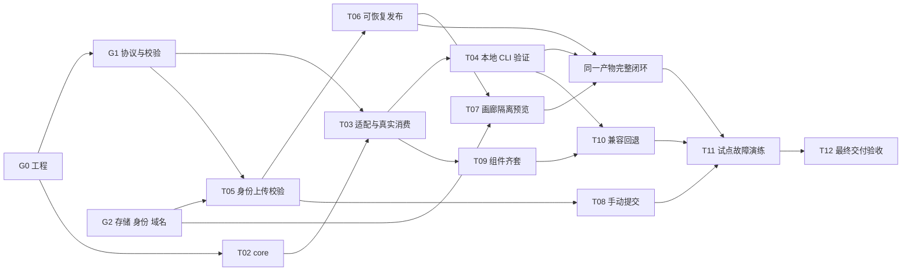

# 三人分工、并行关系与必要依赖

日期：2026-11-11。当前投入：先安排 3 名开发，人员可动态调整；目标窗口截至 2026-12-31。本文是当前执行排期，替代评估文档中按更充裕人力拟定的里程碑日期；T01–T17 编号、验收标准与原工作量估计保留。

2026-11-12 执行更新：C 主责补齐 G1 运行时校验、错误码和 fixtures，按本次要求在 **2026-11-13 前完成 A/B 示例、截图与报告契约评审**；具体建议时点、回执模板和 G2 五项接入责任/日期见 [G1 评审与 G2 接入清单](2026-11-12-g1-review-g2-access.md)。G1 仍待实际验证与人工回执，G2 目标仍为 2026-11-18；本更新不改变已完成任务的历史验证记录。

## 1. 先明确容量和当前起点

2026-11-12 至 2026-12-31 有 36 个周一至周五工作日，未扣除组织休假。按每人 80% 有效投入：`3 × 36 × 0.8 = 86.4` 开发人日，每人 28.8。一期 T01–T12 仍为 **72–95 开发人日**，中值 83.5，距离容量只剩 2.9 人日；上界缺 8.6 人日。串行依赖可能比总量更早造成延期。

因此，三人可以按一期目标推进，但**不能承诺完整一期年底必达**。需要另安排测试 12–18 人日、运维 5–8 人日的兼职支持；他们不是隐藏的第四名全职开发。如果这些工作也由三人承担，总需求为 89–121 人日，连下界都超过现有容量。11 月 11 日的自动初始化不作为已经节省了若干完整开发人日，后续按实际剩余工作重估。

本次已建立工程基线 G0：10 个 workspace 成员、本地工具链、锁文件、构建/类型检查/测试入口、协议类型草案、NestJS 服务健康检查、React 画廊与双框架示例壳。根据用户补充，API/预览网关使用 NestJS 12.4.2，平台前端从 React + Vite 调整为 React 19.3.1 + Next.js 16.4.6；公开发现页支持 SSG/ISR，控制台路由预留登录保护；原架构的 Vue/React 组件范围保留。验证范围见 [当前调整记录](../../verification/nest-react-bootstrap.md) 与 [画廊迁移计划](2026-11-11-gallery-next-public-private.md)。**完整 T01 仍未完成，图表组件、发布功能也尚未实现。**

| 门槛 | 内容与负责人 | 当前状态 / 目标 |
| --- | --- | --- |
| G0 工程可协作 | 安装、依赖图、构建、类型检查、基础测试；C 接管根配置 | 本次初始化交付 |
| G1 协议可并行 | C 主责 schema/API/错误码；A 定义 core/示例就绪协议；B 核对 CLI/截图/报告；共同确认 fixtures | 11-12 实现候选待最终验证；本次评审目标改为 2026-11-13，A/B 实际回执与人工通过仍待完成 |
| G2 外部条件可联调 | C 对五项接入负总责；兼职运维/身份/DNS 等外部交付角色实名待确认 | 未验证，目标 2026-11-18；各项计划日期待交付方确认，外部延迟须当天暴露 |

G1 交付物：JSON Schema 与版本策略、运行时校验器、正常/缺图/错框架/错摘要/伪造来源 fixtures、API 请求响应样例、示例 ready/runState/getChecks 协议。类型草案不等于 G1 通过。

G2 交付物：三存储写读与进程重启恢复记录、固定版本/镜像摘要、OIDC 客户端及回调、独立注册域的 wildcard DNS/TLS 与权限方案。健康检查返回 200 不等于 G2 通过。

## 2. 三人职责与工作量

A：SDK 与图表核心，主目录 `packages/charts-*`、双框架 examples。
B：CLI、本地验证、React 画廊与手动提交，主目录 `packages/component-cli`、`apps/gallery`、消费者和浏览器测试。
C：NestJS 平台与工程负责人，主目录 `apps/api`、`apps/preview-gateway`、`packages/contracts`、`infra`、根工具链配置。

技术栈带来的协作边界：C 维护 Nest 模块、controller/service、认证和作业状态；B 根据 contracts 与固定 fixtures 实现 Next.js React 页面，通过 HTTP 契约联调，不导入后端 Nest 模块。公开发现页面与登录后控制台属于同一 Next 应用的不同路由组；真实上传、目录和预览验收必须等待 T05/T06/T07 对应服务。A 的 Vue/React SDK 工作无需等待画廊完成。两个后端沿用独立 Nest 入口，不在初始化时合并为单一服务。

下表为开发人日分配，列相加等于原任务估计；不是三个人都全时参与同一个任务。

| 任务 | 总量 | A | B | C | 交付与边界 |
| --- | ---: | ---: | ---: | ---: | --- |
| T01 基线/协议/设施 | 5–7 | 1 | 1 | 3–5 | A/B 评审各自协议和样例；C 完成 schema、基础设施与版本验证 |
| T02 core/折线图 | 6–8 | 6–8 | — | — | 控制器、数据事件、生命周期测试 |
| T03 Vue/React 适配 | 7–9 | 5–6 | 2–3 | — | A 组件和示例；B 工作区外真实 tarball 消费与包结构检查 |
| T04 CLI/截图/基线 | 9–12 | — | 9–12 | — | 本地冻结、截图、报告、恢复与基线命令 |
| T05 身份/上传/校验 | 7–9 | — | — | 7–9 | OIDC、授权、上传、逐实现校验、元数据 |
| T06 发布一致性 | 8–10 | — | 2–3 | 6–7 | B 注册表摘要/依赖可达性适配器与测试；C 持久化作业、租约、幂等与恢复 |
| T07 画廊/隔离预览 | 6–8 | — | 3–4 | 3–4 | B 目录详情/UI；C 预览授权、独立 origin、静态网关 |
| T08 网页手动提交 | 3–4 | — | 3–4 | — | 复用上传 API；逐实现缺图拦截和来源标识 |
| T09 基础/场景组件 | 6–8 | 6–8 | — | — | 共 7 个逻辑组件、14 个框架实现 |
| T10 升级/兼容/回退 | 4–6 | 3–4 | 1–2 | — | A 组件兼容修正；B 精确矩阵、消费者执行与报告 |
| T11 试点/故障演练 | 6–8 | 2–3 | 2 | 2–3 | A 两个业务项目；B 回归验证；C 故障注入与观测 |
| T12 交付/恢复/验收 | 5–6 | 1 | 1–2 | 3 | A SDK 文档；B CLI/UI 操作手册；C 部署、恢复与上线核验 |
| **合计** | **72–95** | **24–31** | **24–33** | **24–31** | 中值 A 27.5、B 28.5、C 27.5；每人容量 28.8 |

B 在中值下几乎无余量，C 掌握最长发布链路。增援优先顺序：有平台能力的人接 C 的网关/部署验证，或前端接 B 的 T07/T08；不要只给 A 增加图表人手。移交时把工时从原负责人扣除，再计入接手人，不能重复统计。

## 3. 哪些可并行，哪些必须等待

“开工依赖”表示接口和输入已足够开始编码；“验收依赖”表示必须有真实产物和服务证据。stub 仅帮助开工，不能完成验收。

| 任务 | 开工所需最小输入 | 可并行的工作 | 必须等待的验收依赖 |
| --- | --- | --- | --- |
| T02 | G0、A 确认 core 类型草案 | 与 G1/G2、CLI 骨架、T05 设计并行 | 核心生命周期与真实渲染测试 |
| T03 | core 公共接口、G1 示例协议 | A 写框架壳，B 写消费者模板；无需等整个 T02 完工 | T02 可用；候选 core/框架 tarball 实际安装，不能用源码 alias |
| T04 | G1 manifest、示例协议与上传 API | 先做摘要/冻结/CLI 参数/报告/截图 runner，用契约样例接 API | T03 真实消费者和截图；完整 release 还需 T05/T06、基线 API |
| T05 | G1 schema 与授权规则 | C 做 API/数据库；B/A 使用固定 fixtures | G2 三存储/OIDC可接；跨实现缺图、摘要和来源校验通过 |
| T06 | 作业状态机、T05 上传完成契约 | B 写注册表适配器；C 写协调器，两人按文件边界分开 | T05 真实校验产物、PG/Verdaccio/MinIO；core 先发布；中断恢复演练 |
| T07 | 目录/详情/preview-grant 契约 | B 做 UI；C 设计网关与隔离策略 | T05 权限、T06 Ready 元数据和文件、G2 域名/TLS；真实浏览器隔离测试 |
| T08 | G1 schema、T05 API | B 可用 fixtures 完成表单和逐实现缺图提示 | 真上传/真校验；web 强制 manual-upload，不能借图或伪造自动验证 |
| T09 | T02/03 已稳定的组件模式 | A 补齐组件时，B/C 继续发布平台 | 全部双框架实现和消费者记录 |
| T10 | T03 消费者、T04 报告协议 | B 可先搭矩阵 runner；A 整理升级样例 | T03/T04/T09 可执行；精确版本验证和回退，不能只检查版本号 |
| T11 | 试点联系人/项目、故障清单 | 用例设计和观测准备提前；完成的模块可持续预演 | M2 完整闭环 + T08 + T10；stub 和局部预演不算最终试点通过 |
| T12 | 部署目标、配置/备份约定 | 手册、部署模板、备份准备从第一周持续补 | T11 通过后最终验收；恢复后引用完整、可重复操作 |

以下箭头均表示**验收硬依赖**，不是要求前一个任务全部结束后才开始写后一个任务：

跨团队最关键的交接物是：A→B 的真实候选 tarball 和示例协议；B→C 的同一冻结产物/manifest/摘要/报告；C→B 的上传/任务/目录/预览接口及真实测试账号。截图后重新打包、服务端构建组件、使用 workspace 安装冒充消费者验收，都不能用于“赶进度”。

## 4. 三人日历安排

下表按估算中值排列主要工作，不表示每项都可无条件按日完成。每人每周最多 4 个有效开发人日；同一格内串行切换，不能视为同一人并行满载。

| 时间 | A：SDK | B：工具链与前端 | C：平台 | 检查点 |
| --- | --- | --- | --- | --- |
| 11-12～11-13 | core/示例协议、T02 测试；评审 ready/runState/getChecks 与双框架语义 | 评审冻结产物、截图/报告/API 及失败 fixtures；T03 消费者模板 | G1 实现/验证与 A/B 评审收口、G2 接入责任/日期 | 11-13 A/B 评审目标；建议 12:00 回执、17:00 C 收口，未确认 |
| 11-16～11-20 | T02 生命周期与折线图 | T03 消费者设施、T04 冻结/摘要 | G2 收口，T05 开工；G1 有阻断则继续修正 | 11-18 G2；G1 未得人工回执不得标完成 |
| 11-23～11-27 | T02 收口、T03 适配 | T04 CLI/截图 runner | T05 身份上传与校验 | 实际包最早样本交 B |
| 11-30～12-04 | T03 收口、T09 开始 | T04 双框架报告/基线/恢复 | T05 收口、T06 作业 | 12-04 M1 本地一图闭环；首次重估 |
| 12-07～12-11 | T09 图表与场景 | T04 收口、T06 注册表适配、T07 UI开始 | T06 幂等/恢复 | 本地与服务逐段联调 |
| 12-14～12-18 | T09 收口、T10 升级候选 | T07 UI、T08 手动入口 | T06 收口、T07 网关 | 12-16 容量复核；M2 候选验证 |
| 12-21～12-25 | T10 收口、T11 已就绪试点 | T08/T10 收口，T11 回归 | T07 收口；T12 准备；T11 故障演练 | M2 目标 12-21；齐套目标 12-24 |
| 12-28～12-31 | T11 修复、T12 SDK 文档 | T11 回归、T12 操作手册 | T11 修复/复验、T12 最终核验 | 满足全部门槛才确认 M5 |

三人计划中 M2 从原评估建议的 12-04 延后至约 12-21，体现人员负载与依赖成本。最后一周余量很小，不能继续沿用四人假设下的早期日期。M2 必须包含 CLI→真实上传→三存储→Ready→画廊/隔离预览→两类干净消费者，且包/截图/示例/报告可追溯、中断可恢复。

风险触发：G1/G2 晚于目标 2 个工作日、12-04 仍无双框架真 tarball 消费、12-16 仍无可恢复发布样例，任一出现就当天重排。每周按实际可用天数更新 A/B/C 剩余负载和剩余容量；需要增援或正式调整范围，不能靠压缩一致性/权限/恢复验收保持日期。如果年底只能交受控试点，应明确称为试点、列出未完成 T 编号，不标成完整一期上线。

## 5. 立即可分配的前三个工作日

| 人员 | 11-12～11-16 的具体任务 | 可审查交付 | 等待/协作点 |
| --- | --- | --- | --- |
| A | 定 core 的 data/config/event/controller 接口；写零尺寸/卸载/更新失败测试；评审 ready/runState/getChecks 与双框架示例语义 | core 类型 PR、测试红灯、折线图实现起步、实际契约回执 | 11-13 前把接口样例给 B 并评审 G1；建议 12:00 回执，待确认；不等待上传后端 |
| B | 评审 manifest/截图/报告/API 与失败 fixtures；创建工作区外消费者目录策略与候选 core 覆盖方案；拆 CLI freeze/check 子模块 | tarball fixture、消费者测试入口、冻结流程草图、实际契约回执 | 11-13 评审 G1，建议 12:00 回执，待确认；合成 fixture 不代替 A 的实际包验收 |
| C | 实现 manifest 校验/错误码/反例，冻结上传/作业/目录响应；整理 G2 五项接入清单并推进联系人确认 | schema+API 样例、实际验证记录、评审问题收口、外部接入角色/计划日期与待确认实名 | 11-13 前组织 A/B 评审，建议 17:00 收口，待确认；未取得回执不称通过，G2 接入阻塞当天记录 |

## 6. 协作与合并规则

- C 维护根 package.json、workspace、lockfile、Turbo、contracts；A/B 依赖变更通过小 PR 提交，由 C 统一安装更新锁文件，禁止三份锁文件手工拼接。公开包版本仍处于 0.0.0 骨架阶段，不直接发布。
- T06 的 B 只改注册表适配器和对应测试，C 改 jobs/数据库/协调器；T07 的 B 改 gallery，C 改 preview-gateway。新增接口先同步契约和 fixtures，再改调用方。
- 分支建议 `feat/t02-core`、`feat/t04-cli`、`feat/t05-platform`；每个 PR 写清任务编号、前置契约版本、已跑命令、剩余阻塞。至少一名非作者审查契约/发布边界，评审占用已计入 20% 协作余量。
- 合并门槛：冻结安装、workspace 检查、相关构建/类型/行为测试；触碰公共包则跑全图；平台 CI 使用 `build:services` 白名单。副作用验收直接运行，不得因 Turbo 缓存跳过消费者、截图、基线或发布。
- 不按“写完代码”交接：同时提交真实输入、预期输出、失败示例、执行命令、责任人和下一截止日期。人员轮换必须继承这些交付物及尚未通过的门槛。

## 7. 后续阶段

T13–T14（二期档案检索、设计稿匹配）为 28–42 开发人日，依赖一期 Ready 目录、真实 API/截图和评估集；T15–T17（三期识别、接入、验证/MCP）为 35–50 人日，依赖二期可验证装配方案及真实项目。三人当前不排入年底承诺；一期通过后再按实际人员分配，避免与 T04/T06/T11 争抢关键资源。
